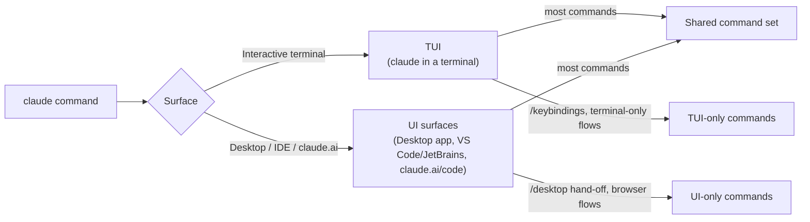
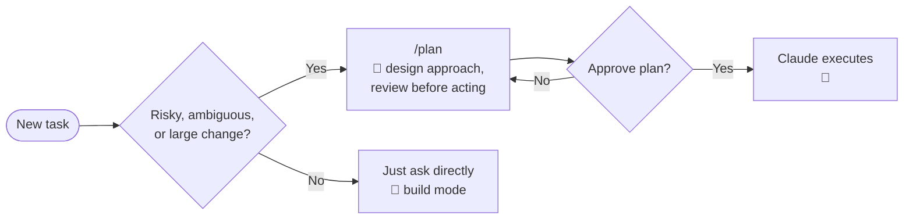
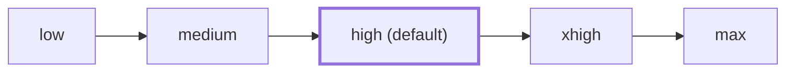
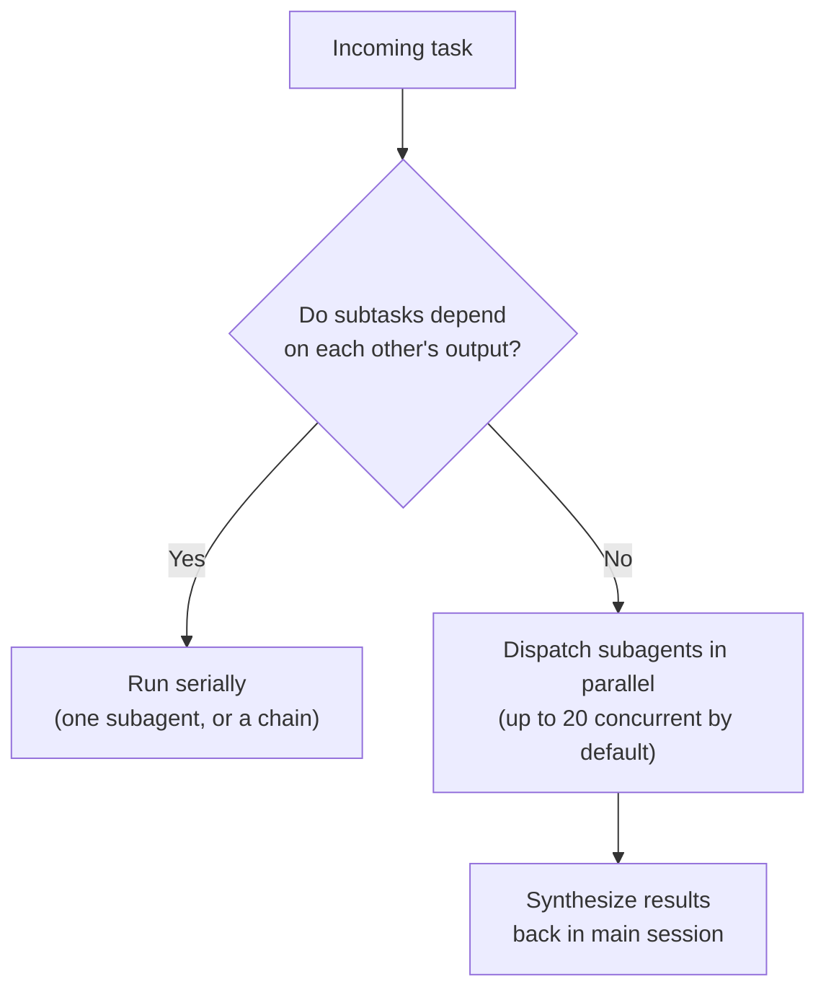

# Claude Code Guide

### Slash commands, models, effort, and sub-agent workflow — for developers new to agentic coding

> This is a **conceptual/workflow guide**, not a terse flag reference. For the exhaustive CLI flag tables and keybindings, see the companion cheat sheets: [`claude-code-cli-windows.md`](claude-code-cli-windows.md) / [`claude-code-cli-linux-mac.md`](claude-code-cli-linux-mac.md) and [`claude-code-keybindings-windows.md`](claude-code-keybindings-windows.md) / [`claude-code-keybindings-linux-mac.md`](claude-code-keybindings-linux-mac.md).

**Written for Claude Code CLI v2.1.238** (latest as of 2026-08-21). Slash commands, flags, and versions change frequently — verify against `claude --version` and `/help` in your installed copy before relying on anything here for something version-sensitive.

---

## Table of contents

1. [Where commands run: TUI vs UI](#1-where-commands-run-tui-vs-ui)
2. [Built-in slash commands](#2-built-in-slash-commands)
3. [Command-line arguments](#3-command-line-arguments)
4. [Models — which one, when](#4-models--which-one-when)
5. [Effort levels](#5-effort-levels)
6. [Sub-agent dispatch: parallel vs serial](#6-sub-agent-dispatch-parallel-vs-serial)
7. [Glossary: Skills, Agents, Plugins, MCP, Hooks, LSP](#7-glossary-skills-agents-plugins-mcp-hooks-lsp)
8. [Other useful concepts](#8-other-useful-concepts)
9. [Sources](#9-sources)

---

## 1. Where commands run: TUI vs UI

Claude Code isn't one surface — it's several, and not every slash command exists on every surface.

- **TUI** (Terminal UI) — the interactive terminal session you get from running `claude`. This is the primary, most fully-featured surface and where the vast majority of slash commands live.
- **UI surfaces** — the Claude Code **Desktop app** (macOS / Windows x64), the **VS Code / JetBrains IDE extensions**, and the **web app** at claude.ai/code. These share most TUI commands but add a few of their own (e.g. `/desktop` to hand a session to the desktop app) and lack a few TUI-only ones (e.g. `/keybindings`, which opens a local keybindings file; `/tmux`-style terminal integration).

In the tables below, every command defaults to **"Both"** unless explicitly marked **TUI-only** or **UI-only** — per your request, we don't call out the surface when a command works everywhere.



---

## 2. Built-in slash commands

Legend — **Mode**: 🧭 Plan (read-only thinking/design, no changes) · 🔨 Build (executes changes) · 🛠️ Utility (neither — session/account/display management).

### Session management

| Command | Mode | What it does | When to use it | Usage |
|---|---|---|---|---|
| `/clear` (aka `/reset`, `/new`) | 🛠️ | Starts a new conversation, keeps project memory (CLAUDE.md) | Starting a new, unrelated task in the same project | `/clear [name]` |
| `/resume` | 🛠️ | Returns to an earlier conversation | Picking up where you left off | `/resume` |
| `/branch` | 🛠️ | Creates a conversation branch to try a different direction, preserving the original | You want to try an alternate approach without losing your current thread | `/branch [name]` |
| `/fork` | 🛠️ | Copies the current conversation to a **background** session while you keep working in the foreground | Spinning off a side investigation without blocking your main flow (v2.1.212+) | `/fork [prompt]` |
| `/background` (`/bg`) | 🛠️ | Detaches the current session to run as a background agent, freeing the terminal | You want to hand off a long task and keep using the terminal for something else | `/background [prompt]` |
| `/exit` (`/quit`) | 🛠️ | Exits the CLI (background work keeps running) | Done for now | `/exit` |

**Example:**
```
/fork investigate why the nightly build is flaky
```
Keeps your current session free while a background copy chases the flaky-build lead.

### Model & performance

| Command | Mode | What it does | When to use it | Usage |
|---|---|---|---|---|
| `/model` | 🛠️ | Switches the active model; saves as default for new sessions (press `s` for session-only) | Balancing cost/speed/capability mid-session — see [§4](#4-models--which-one-when) | `/model [sonnet\|opus\|haiku\|fable\|<full-id>]` |
| `/effort` | 🛠️ | Sets reasoning depth: `low`/`medium`/`high` (default)/`xhigh`/`max` | Trading capability for speed/cost — see [§5](#5-effort-levels) | `/effort [level\|auto]` |
| `/fast` | 🛠️ | Toggles Fast mode (Opus with faster output; limited in `-p` mode) | You want Opus-quality output without the usual latency | `/fast [on\|off]` |

### Context & memory

| Command | Mode | What it does | When to use it | Usage |
|---|---|---|---|---|
| `/memory` | 🛠️ | Edits CLAUDE.md files, toggles auto memory, views stored entries | Teaching Claude a persistent fact about your project or preferences | `/memory` |
| `/context` | 🛠️ | Visualizes context-window usage as a colored grid, with optimization suggestions | Diagnosing "why is this session slow / about to run out of room" | `/context [all]` |
| `/compact` | 🛠️ | Summarizes the conversation to free context, preserving rules/skills/memory | Long session getting unwieldy but you want to keep working in it | `/compact [instructions]` |
| `/autocompact` | 🛠️ | Sets the automatic compaction threshold | You want compaction to trigger earlier/later than default (v2.1.221+) | `/autocompact [auto\|<tokens>]` |

**Example:**
```
/compact keep the auth-bug findings, drop the exploratory dead ends
```

### Code review & quality

| Command | Mode | What it does | When to use it | Usage |
|---|---|---|---|---|
| `/code-review` (`/review`) | 🧭 | Reviews a diff/PR for bugs and cleanup opportunities; `ultra` runs a deep multi-agent cloud review | Before merging, or when you want a second pair of eyes on your own diff | `/code-review [level] [--fix] [--comment] [pr#\|branch\|path]` |
| `/security-review` | 🧭 | Checks the current diff for security vulnerabilities | Before merging anything touching auth, input handling, secrets, or infra | `/security-review` |
| `/diff` | 🧭 | Opens an interactive diff viewer for uncommitted changes | Visually reviewing your own working-tree changes | `/diff` |

**Example:**
```
/code-review high --fix
```
Runs a thorough review and applies the fixes it finds directly.

### Planning & workflow

| Command | Mode | What it does | When to use it | Usage |
|---|---|---|---|---|
| `/plan` | 🧭 | Enters Plan Mode directly — Claude designs an approach and gets your approval before touching anything | Any change risky, ambiguous, or large enough that you want to review the approach first | `/plan [description]` |
| `/batch` | 🔨 | Orchestrates a large-scale change across 5–30 parallel git worktrees with subagents | A mechanical, repo-wide change (framework migration, rename, codemod) too big for one session | `/batch <instruction>` |
| `/goal` | 🔨 | Sets a goal; Claude keeps working autonomously until the condition is met | Long-running tasks where you want "keep going until X is true" rather than turn-by-turn babysitting | `/goal [condition\|clear]` |
| `/loop` (`/proactive`) | 🔨 | Repeats a prompt on an interval while the session stays open | Polling for external state (CI status, deploy completion) | `/loop [interval] [prompt]` |

**Example:**
```
/batch migrate src/ from Solid to React
```



### Permissions & configuration

| Command | Mode | What it does | When to use it | Usage |
|---|---|---|---|---|
| `/permissions` (`/allowed-tools`) | 🛠️ | Manages allow/ask/deny rules by scope | Tuning how much Claude can do without asking | `/permissions` |
| `/add-dir` | 🛠️ | Adds an additional working directory for the session | Working across a monorepo or sibling repo | `/add-dir <path>` |
| `/cd` | 🛠️ | Moves the session's working directory, preserving conversation | Switching context without losing history | `/cd <path>` |
| `/init` | 🛠️ | Initializes the project with a starter CLAUDE.md (interactive flow with `CLAUDE_CODE_NEW_INIT=1`) | First time running Claude Code in a repo | `/init` |
| `/mcp` | 🛠️ | Manages MCP server connections and OAuth | Connecting/troubleshooting an MCP server | `/mcp [reconnect <server>\|enable\|disable [<server>\|all]]` |

### Debugging & diagnostics

| Command | Mode | What it does | When to use it | Usage |
|---|---|---|---|---|
| `/doctor` (`/checkup`) | 🛠️ | Runs a setup checkup (install health, unused skills/MCP, slow hooks, stale CLAUDE.md) | Something feels off, or periodic maintenance | `/doctor` |
| `/debug` | 🛠️ | Enables debug logging for the session, optionally focused on an issue | Diagnosing unexpected Claude Code behavior | `/debug [description]` |
| `/rewind` | 🛠️ | Rolls code and conversation back to a checkpoint | Undoing a bad edit or bad conversational turn | `/rewind` |
| `/heapdump` | 🛠️ | Writes a heap snapshot for troubleshooting (hidden — type the full command) | Reporting a memory/perf bug to Anthropic | `/heapdump` |

### File & output

| Command | Mode | What it does | When to use it | Usage |
|---|---|---|---|---|
| `/copy` | 🛠️ | Copies the last assistant response (or Nth-latest) to clipboard | Grabbing a code block or answer to paste elsewhere | `/copy [N]` |
| `/export` | 🛠️ | Exports the conversation as plain text | Archiving or sharing a session transcript | `/export [filename]` |

### Account & setup

| Command | Mode | What it does | When to use it | Usage |
|---|---|---|---|---|
| `/login` / `/logout` | 🛠️ | Signs in/out of your Anthropic account | Auth setup | `/login` |
| `/upgrade` | 🛠️ | Upgrades your plan (not on Enterprise) | Hitting usage limits | `/upgrade` |

### Display & UX

| Command | Mode | What it does | When to use it | Usage |
|---|---|---|---|---|
| `/help` | 🛠️ | Shows help and available commands | Discovering what's available | `/help` |
| `/status` | 🛠️ | Shows session status immediately (doesn't queue) | Quick health check mid-response | `/status` |
| `/tasks` | 🛠️ | Lists background work, including finished subagents | Checking on dispatched background/subagent work | `/tasks` |
| `/usage` (`/cost`) | 🛠️ | Shows API usage and cost | Budget tracking | `/usage` |
| `/theme` (`/color`) | 🛠️ | Sets the prompt bar color | Visually distinguishing sessions | `/theme [color\|default]` |
| `/config` (`/settings`) | 🛠️ | Opens Settings, or sets values directly | Changing persistent config | `/config [key=value ...]` |
| `/focus` | 🛠️ | Toggles a minimal focus view (fullscreen only) | Reducing visual noise while reading a long response | `/focus` |

### Integrations

| Command | Mode | What it does | When to use it | Usage |
|---|---|---|---|---|
| `/install-github-app` | 🛠️ | Installs the Claude GitHub App, optionally with Actions | Wiring Claude into your GitHub repo's automation | `/install-github-app` |
| `/install-slack-app` | 🛠️ | Installs the Claude Slack app | Bringing Claude into Slack | `/install-slack-app` |
| `/desktop` (`/app`) — **UI-only** | 🛠️ | Continues the current session in the Claude Code Desktop app | Switching from terminal to desktop mid-session (macOS / Windows x64, subscription required) | `/desktop` |
| `/keybindings` — **TUI-only** | 🛠️ | Opens the local keybindings file for customization | Rebinding terminal shortcuts | `/keybindings` |

### Advanced / power-user

| Command | Mode | What it does | When to use it | Usage |
|---|---|---|---|---|
| `/btw` | 🛠️ | Asks a side question without polluting the main conversation history | Quick tangential question | `/btw [question]` |
| `/fewer-permission-prompts` | 🛠️ | Scans your transcripts for common read-only calls and adds an allowlist to `.claude/settings.json` | Tired of approving the same safe commands repeatedly | `/fewer-permission-prompts` |
| `/verify` | 🧭 | Runs verification checks manually (no longer autonomous as of v2.1.215) | Confirming a change actually works before moving on | `/verify` |
| `/import` | 🛠️ | Imports config (instructions, MCP servers, commands, subagents, skills) from Codex or Gemini CLI | Migrating from another agentic CLI | `/import [codex\|gemini] [--dry-run] [--yes]` |
| `/plugin` | 🛠️ | Manages plugins: `list`, `install`, `enable`, `disable` | Installing/managing a plugin bundle | `/plugin [subcommand]` |
| `/autofix-pr` | 🔨 | Spawns a cloud session that watches a PR and pushes fixes for CI failures | Hands-off PR maintenance | `/autofix-pr [prompt]` |
| `/advisor` | 🛠️ | Enables a second model to give guidance alongside the primary one | Wanting a "second opinion" model in the loop | `/advisor [model\|off]` |
| `/hooks` | 🛠️ | Views hook configurations | Inspecting what automation is wired into this session | `/hooks` |
| `/list-agents` (`/peers`) | 🛠️ | Lists subagents and other Claude Code sessions you can message | Coordinating multiple concurrent sessions (v2.1.224+) | `/list-agents` |

> The full command surface is large (60+ commands as of v2.1.238) and some are hidden until typed in full, version-gated, or region-gated (unavailable on Bedrock/Google Cloud Agent Platform/Microsoft Foundry/AWS for certain features). Run `/help` in your session for the authoritative, version-matched list.

---

## 3. Command-line arguments

The `claude` binary's full flag reference lives in the companion cheat sheets — [Windows](claude-code-cli-windows.md) / [Linux/macOS](claude-code-cli-linux-mac.md) — and is kept current there. Below is the subset most relevant to **agentic workflow** decisions covered in this guide.

| Flag | Purpose | Relates to |
|---|---|---|
| `--model <name\|id>` | Set model for the session | [§4 Models](#4-models--which-one-when) |
| `--effort <level>` | Set reasoning effort | [§5 Effort levels](#5-effort-levels) |
| `--permission-mode <mode>` | Start in a permission mode (`default`, `acceptEdits`, `plan`, `auto`, `dontAsk`, `bypassPermissions`) | [§8 Permission modes](#8-other-useful-concepts) |
| `--agent <name>` / `--agents <json>` | Select or define subagents for the session | [§6 Sub-agent dispatch](#6-sub-agent-dispatch-parallel-vs-serial) |
| `--bg` / `--background` | Start as a background agent | [§6 Sub-agent dispatch](#6-sub-agent-dispatch-parallel-vs-serial) |
| `--worktree <name>` / `-w <name>` | Start in an isolated git worktree | [§8 Worktrees](#8-other-useful-concepts) |
| `--continue` / `-c`, `--resume` / `-r <session>` | Resume prior work | Session management ([§2](#2-built-in-slash-commands)) |
| `--fallback-model <models>` | Comma-separated fallback models if the primary is unavailable | [§4 Models](#4-models--which-one-when) |
| `--max-turns <n>`, `--max-budget-usd <usd>` | Guardrails for unattended/CI runs | Automation |
| `--dangerously-skip-permissions` | Skip all permission prompts | Trusted sandboxes/CI only — see [§8](#8-other-useful-concepts) |

**Example — unattended CI run with guardrails:**
```bash
claude -p --model claude-sonnet-5 --effort medium --max-turns 20 --max-budget-usd 2.00 "Fix all lint errors"
```

---

## 4. Models — which one, when

| Model | Alias | Context | Best for |
|---|---|---|---|
| **Claude Fable 5** | `fable` | 1M tokens | Highest-capability long-running agents, deep multi-hour research and reasoning |
| **Claude Opus 5** | `opus` | 1M tokens | Complex agentic coding, large-scale refactors, enterprise systems work, vision-heavy tasks |
| **Claude Sonnet 5** | `sonnet` | 1M tokens | The default for most day-to-day coding, agentic tool use, content work — best speed/intelligence balance |
| **Claude Haiku 4.5** | `haiku` | 200k tokens | Fast, cheap, high-volume or sub-agent tasks; near-frontier intelligence at low cost |

**Practical guidance:**
- **Default to Sonnet** for everyday development — it's the balance point Anthropic tunes for.
- **Reach for Opus** when a task is genuinely hard: large refactors, subtle bugs, multi-hour autonomous work, or anything where getting it wrong is expensive.
- **Reach for Fable** for the most demanding long-horizon agentic work where Opus-level effort still isn't enough headroom.
- **Reach for Haiku** for cheap, fast, high-volume work — a great choice for *subagents* doing narrow, well-defined jobs (see [§6](#6-sub-agent-dispatch-parallel-vs-serial)) where you don't need frontier reasoning.
- Switch mid-session with `/model` or set per-launch with `--model`.

---

## 5. Effort levels

Effort controls how much the model "thinks" before responding — separate from *which* model you pick. Levels: `low` · `medium` · `high` (**default**) · `xhigh` · `max`.

| Level | Use it when |
|---|---|
| `low` | Simple, well-defined tasks; high-volume/latency-sensitive, non-coding work |
| `medium` | Routine agentic tasks where you want a deliberate cost/speed step-down from default |
| `high` (default) | Complex reasoning, difficult coding, most agentic tasks — leave this alone unless you have a reason not to |
| `xhigh` | Long-horizon coding/agentic tasks (30+ minutes, large context) where you need the extra headroom |
| `max` | Absolute hardest problems — no token constraints on thinking depth |

**Practical guidance:** start at the default (`high`) and only move. Step **down** to `medium`/`low` for routine, well-understood work to save cost and latency — evals generally hold quality at those levels for simpler tasks. Step **up** to `xhigh`/`max` for the hardest, highest-stakes work, especially with Opus or Fable.



Set it with `/effort <level>` mid-session or `--effort <level>` at launch.

---

## 6. Sub-agent dispatch: parallel vs serial

**Subagents** are specialized Claude instances that run in **isolated context windows**, delegated to via the Agent tool when a task matches their `description`. Configure them in `.claude/agents/<name>.md` (project-scoped, check into version control) or `~/.claude/agents/` (personal, all projects), or define them ad hoc with `--agents '<json>'`.

### When to go parallel vs serial

- **Serial** — tasks with a data dependency, where step 2 needs step 1's output (e.g. "design the schema, then implement it"). Running these in parallel just wastes effort re-deriving context each subagent doesn't have.
- **Parallel** — independent tasks whose results you'll synthesize afterward (e.g. "review these three unrelated modules for bugs"). This is where subagents earn their keep: each gets a clean context window instead of polluting your main conversation.



**Practical rules of thumb:**
- Don't parallelize for its own sake — each subagent costs its own context/tokens, and synthesizing many results back can itself burn context.
- Prefer parallel dispatch for *read-only exploration/research* fan-out (e.g. "search these five directories for X") — low risk, easy to merge.
- Prefer serial for anything that edits shared state or depends on a prior step's decision.
- Concurrency defaults to 20 simultaneous subagents; tune with `CLAUDE_CODE_MAX_CONCURRENT_SUBAGENTS`. Subagents can nest up to 3 layers deep by default (`CLAUDE_CODE_MAX_SUBAGENT_SPAWN_DEPTH`).
- A **fork** (`/fork` or `/subtask`) is a special subagent that inherits your *entire* current conversation instead of starting fresh — cheaper than a fresh subagent (shares prompt cache) and useful for trying an alternate approach from where you already are.
- Background subagents run concurrently while you keep working, with a restricted tool set; foreground subagents block the conversation until done but get full tool access — pick foreground when you need the result before continuing.

**Example — parallel research fan-out:**
```
Dispatch three subagents in parallel to review the auth, billing, and
notifications modules independently for security issues, then summarize
the combined findings.
```

**Example — serial chain:**
```
First have a subagent design the migration plan, then once approved,
have a second subagent implement it.
```

---

## 7. Glossary: Skills, Agents, Plugins, MCP, Hooks, LSP

| Concept | What it is | Use it for |
|---|---|---|
| **Skill** | A Markdown file (`SKILL.md`) with instructions Claude loads only when relevant — either automatically (matched by description) or explicitly via `/skill-name`. | Turning a repeated procedure/checklist you keep re-explaining into something Claude finds on its own. |
| **Agent / Subagent** | A specialized Claude instance with its own context window, tool restrictions, and optionally its own model — delegated to for a subtask. See [§6](#6-sub-agent-dispatch-parallel-vs-serial). | Isolating exploration or specialized work from your main conversation. |
| **Plugin** | A distributable bundle combining skills, agents, hooks, MCP servers, and LSP config under one manifest (`.claude-plugin/plugin.json`). | Sharing a whole workflow/toolset across projects or teams, or installing someone else's. |
| **MCP (Model Context Protocol)** | An open standard for connecting Claude to external tools and data — issue trackers, databases, dashboards, APIs — instead of copy-pasting data into chat. | Giving Claude live access to systems outside the repo. |
| **Hook** | A shell command, HTTP call, prompt, or agent handler that fires automatically at a lifecycle point (session start, before/after a tool call, etc.). | Enforcing policy, automating side effects, blocking dangerous actions. |
| **LSP (Language Server Protocol)** | Integration with language servers (e.g. `pyright`, `gopls`) configured per-plugin, giving Claude real-time code intelligence. | Better-informed edits in languages with a running language server. |
| **Agent SDK** | Claude Code's underlying harness (agent loop, context management, tools, hooks, subagents, permissions, MCP) exposed as a library (Python/TypeScript) for building your own agents. | Building a custom agent product rather than using the CLI directly. |

---

## 8. Other useful concepts

- **Permission modes** — `default` (asks before most actions), `acceptEdits` (auto-approves edits, asks for shell/network), `plan` (shows a plan first), `auto` (a second model classifies risk for you), `dontAsk` (approves read-only, asks for destructive), `bypassPermissions` (no prompts — trusted sandboxes/CI only). Set with `--permission-mode` or cycle with `Shift+Tab` in the TUI.
- **CLAUDE.md & memory** — `CLAUDE.md` files give Claude persistent, version-controlled project instructions, loaded every session. **Auto memory** (`/memory`) is separate: notes Claude writes about you and the project based on corrections and context, distinct from what's in the repo.
- **Worktrees** — `claude --worktree <name>` (`-w`) runs a session in an isolated git worktree, so parallel sessions never touch each other's files.
- **Checkpoints & rewind** — `/rewind` rolls code and conversation back to an earlier point — your undo button for a bad edit or bad turn.
- **Statusline** — a customizable shell-script-driven status bar (context usage, cost, git branch) shown at the bottom of the TUI.

---

## 9. Sources

- Slash commands: [code.claude.com/docs/en/commands](https://code.claude.com/docs/en/commands.md)
- CLI reference: [code.claude.com/docs/en/cli-reference](https://code.claude.com/docs/en/cli-reference.md)
- Models overview: [platform.claude.com/docs/.../models/overview](https://platform.claude.com/docs/en/about-claude/models/overview.md)
- Choosing a model: [platform.claude.com/docs/.../choosing-a-model](https://platform.claude.com/docs/en/about-claude/models/choosing-a-model.md)
- Effort parameter: [platform.claude.com/docs/.../effort](https://platform.claude.com/docs/en/build-with-claude/effort.md)
- Sub-agents: [code.claude.com/docs/en/sub-agents](https://code.claude.com/docs/en/sub-agents.md)
- Skills: [code.claude.com/docs/en/skills](https://code.claude.com/docs/en/skills.md)
- Plugins: [code.claude.com/docs/en/plugins](https://code.claude.com/docs/en/plugins.md)
- MCP: [code.claude.com/docs/en/mcp](https://code.claude.com/docs/en/mcp.md)
- Hooks: [code.claude.com/docs/en/hooks](https://code.claude.com/docs/en/hooks.md)
- Memory: [code.claude.com/docs/en/memory](https://code.claude.com/docs/en/memory.md)
- Permission modes: [code.claude.com/docs/en/permission-modes](https://code.claude.com/docs/en/permission-modes.md)
- Worktrees: [code.claude.com/docs/en/worktrees](https://code.claude.com/docs/en/worktrees.md)
- Statusline: [code.claude.com/docs/en/statusline](https://code.claude.com/docs/en/statusline.md)
- Agent SDK overview: [code.claude.com/docs/en/agent-sdk/overview](https://code.claude.com/docs/en/agent-sdk/overview.md)
- Changelog / version: [code.claude.com/docs/en/changelog](https://code.claude.com/docs/en/changelog.md)

---

*Written for Claude Code CLI v2.1.238 · Doc date 2026-08-21 · Commands, flags, and version numbers change frequently — verify against `/help`, `--help`, and `claude --version` in your installed copy.*

*© 2026 Robert H. Engelhardt · Apache 2.0 License*
*Latest version: [https://github.com/rheone/miscellaneous-agentic-tooling](https://github.com/rheone/miscellaneous-agentic-tooling)*
