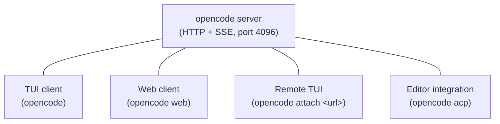
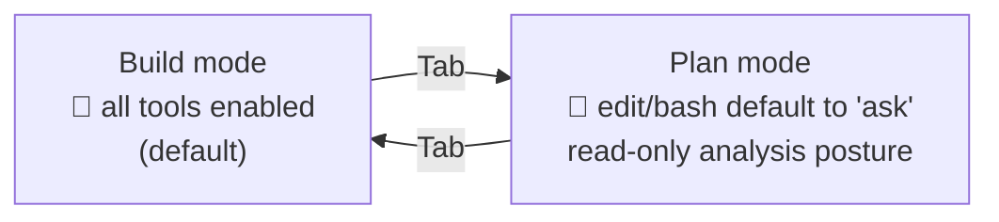
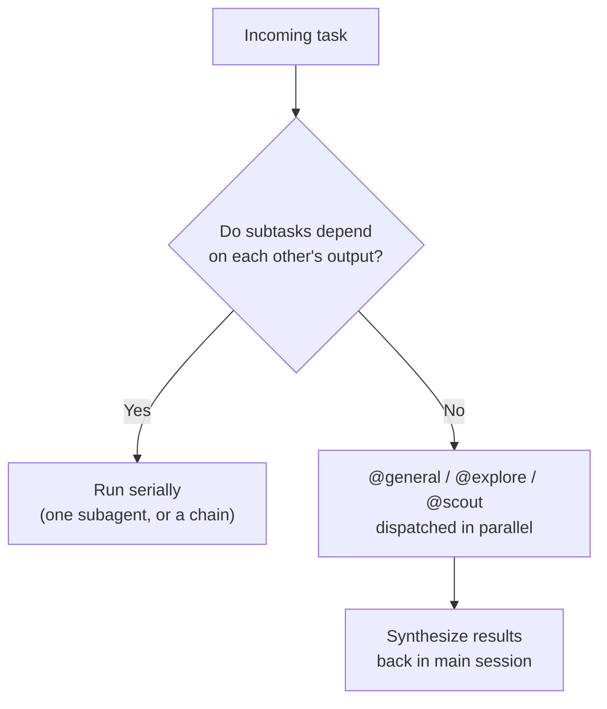

# OpenCode Guide

### Slash commands, models, reasoning variants, and sub-agent workflow — for developers new to agentic coding

> This is a **conceptual/workflow guide**, not a terse flag reference. For the exhaustive CLI flag tables and keybindings, see the companion cheat sheets: [`opencode-cli-windows.md`](opencode-cli-windows.md) / [`opencode-cli-linux-mac.md`](opencode-cli-linux-mac.md) and [`opencode-keybindings-windows.md`](opencode-keybindings-windows.md) / [`opencode-keybindings-linux-mac.md`](opencode-keybindings-linux-mac.md).

**Written for OpenCode v1.18.21** (latest as of 2026-08-21). OpenCode moves fast — verify against `opencode --version` and `/help` in your installed copy before relying on anything here for something version-sensitive.

> **Repo note:** the canonical repo is now [`github.com/anomalyco/opencode`](https://github.com/anomalyco/opencode) — the old `sst/opencode` now redirects there. If you see `sst/opencode` in older links or docs, it's the same project. `github.com/opencode-ai/opencode` is a **different, unrelated** project — don't confuse the two.

---

## Table of contents

1. [OpenCode's architecture, in one picture](#1-opencodes-architecture-in-one-picture)
2. [Built-in slash commands (TUI)](#2-built-in-slash-commands-tui)
3. [Command-line arguments](#3-command-line-arguments)
4. [Models](#4-models)
5. [Reasoning effort: model variants](#5-reasoning-effort-model-variants)
6. [Sub-agent dispatch: parallel vs serial](#6-sub-agent-dispatch-parallel-vs-serial)
7. [Glossary: Skills, Plugins, MCP, Hooks, LSP](#7-glossary-skills-plugins-mcp-hooks-lsp)
8. [Other useful concepts](#8-other-useful-concepts)
9. [Sources](#9-sources)

---

## 1. OpenCode's architecture, in one picture

Unlike a monolithic CLI, the OpenCode **TUI is just one client of an HTTP server** (`opencode serve`, default port 4096) that also powers `opencode web`, `opencode attach`, and editor integrations (`opencode acp`). This matters for a newcomer: everything you can do in the terminal, you can also drive over a REST API, and multiple clients can attach to the same running session.



There's no separate "UI-only vs TUI-only" command split to document here (unlike Claude Code) — OpenCode's commands are TUI slash commands; the web/attach clients are alternate front ends onto the same server, not a separate command surface.

---

## 2. Built-in slash commands (TUI)

Legend — **Mode**: 🛠️ Utility (session/display management, doesn't itself execute or plan). OpenCode does **not** tag individual slash commands as plan vs build — that distinction lives at the **agent** level (see below), not the command level.

| Command | Aliases | What it does | When to use it | Keybind |
|---|---|---|---|---|
| `/new` | `/clear` | Starts a new session | Beginning unrelated work | `<leader>n` |
| `/sessions` | `/resume`, `/continue` | Lists and switches sessions | Picking up earlier work | `<leader>l` |
| `/undo` | — | Undoes the last message in the conversation (repeatable) | Backing out of a bad turn | `<leader>u` |
| `/redo` | — | Redoes a previously undone message | Restoring what you just undid | `<leader>r` |
| `/compact` | `/summarize` | Summarizes the current session to free context | Long session getting unwieldy | `<leader>c` |
| `/export` | — | Exports the conversation to Markdown, opens in your default editor | Archiving/sharing a session | `<leader>x` |
| `/share` | — | Shares the current session (public link, copied to clipboard) | Sending a session to someone else | — |
| `/unshare` | — | Unshares the current session (deletes shared data) | Revoking access | — |
| `/init` | — | Guided setup that creates/updates `AGENTS.md` | First run in a new project | — |
| `/connect` | — | Adds a model provider | Setting up a new provider/API key | — |
| `/models` | — | Lists available models | Choosing/switching models — see [§4](#4-models) | `<leader>m` |
| `/themes` | — | Lists available themes | Customizing the TUI's look | `<leader>t` |
| `/editor` | — | Opens your `$EDITOR` to compose a message | Writing a long or multi-line prompt comfortably | `<leader>e` |
| `/details` | — | Toggles visibility of tool-execution details | Debugging what a tool call actually did |  |
| `/thinking` | — | Toggles visibility of thinking/reasoning blocks | Reading (or hiding) the model's reasoning trace | — |
| `/help` | — | Shows the help dialog | Discovering what's available | — |
| `/exit` | `/quit`, `/q` | Exits OpenCode | Done for now | `<leader>q` |

> **Note:** docs are internally inconsistent on `/theme` vs `/themes` — one page uses each. Try `/themes` first (that's what the TUI command reference lists).

**Other TUI input syntax (not slash commands, but essential):**
- `@` — fuzzy file reference (e.g. `@src/auth.ts fix the bug here`)
- `!` prefix — runs a shell command and includes its output in the conversation

**Example:**
```
/compact
@src/payments/  review this module for edge cases in currency rounding
```

---

### Plan vs Build — a mode switch, not a command

OpenCode has an explicit **Plan mode** that disables the ability to make changes and instead has the model propose *how* it would implement something. Switch with `Tab`; switch back to **Build mode** (the default, all tools enabled) with `Tab` again.



Mechanically, Plan and Build are the two built-in **primary agents** (see [§6](#6-sub-agent-dispatch-parallel-vs-serial)) — the `edit` and `bash` permissions default to `ask` under Plan, and to allowed under Build. You can also set `default_agent` in config to choose which one a session starts in, or select either with `--agent` on the CLI.

---

## 3. Command-line arguments

The `opencode` binary's full flag reference lives in the companion cheat sheets — [Windows](opencode-cli-windows.md) / [Linux/macOS](opencode-cli-linux-mac.md). Below is the subset most relevant to **agentic workflow** decisions covered in this guide.

| Flag / command | Purpose | Relates to |
|---|---|---|
| `-m` / `--model <provider/model>` | Set model for the session | [§4 Models](#4-models) |
| `--variant <name>` (on `opencode run`) | Set reasoning-effort variant | [§5 Reasoning effort](#5-reasoning-effort-model-variants) |
| `--agent <name>` | Select the primary agent (e.g. `plan`, `build`) for the session | [§2 Plan vs Build](#plan-vs-build--a-mode-switch-not-a-command), [§6](#6-sub-agent-dispatch-parallel-vs-serial) |
| `opencode agent create` / `agent list` | Scaffold or list custom agents | [§6 Sub-agent dispatch](#6-sub-agent-dispatch-parallel-vs-serial) |
| `-c` / `--continue`, `-s` / `--session <id>`, `--fork` | Resume or fork prior sessions | Session management ([§2](#2-built-in-slash-commands-tui)) |
| `--auto` | Auto-approve anything not explicitly denied | Guardrail — see [§8 Permissions](#8-other-useful-concepts) |
| `opencode run --format json` | Structured output for scripting/CI | Automation |
| `opencode serve` / `opencode attach` | Run headless / attach a TUI to a running server | [§1 Architecture](#1-opencodes-architecture-in-one-picture) |

**Example — scripted run with a specific model and variant:**
```bash
opencode run -m anthropic/claude-sonnet-5 --variant high --format json "Fix all lint errors"
```

---

## 4. Models

OpenCode is **provider-agnostic** — it supports 75+ providers plus local models, referenced as `provider_id/model_id` (e.g. `anthropic/claude-sonnet-4-20250514`, `lmstudio/google/gemma-3n-e4b`, `opencode/gpt-5.1-codex`).

- Configure a default via `"model"` in `opencode.json`; use `"small_model"` for cheap side-tasks (session titles, etc.).
- Model resolution priority: **CLI `--model`/`-m` → config file → last used model → first model by internal priority.**
- Browse/refresh the catalog with `opencode models [provider]` (`--refresh` to update from models.dev).
- **OpenCode Zen** is an optional first-party gateway of vetted coding models (pay-as-you-go, some free) set up via `/connect` — purely optional, since OpenCode works with your own provider keys too.

**Practical guidance:** since OpenCode doesn't tie you to one vendor, pick per-task: a frontier model (Claude, GPT, Gemini) for the primary agent doing real work, and a cheap/fast model as `small_model` for background bookkeeping (titles, compaction summaries).

---

## 5. Reasoning effort: model variants

OpenCode's equivalent of an "effort level" is the **model variant** — a per-provider reasoning-depth setting, not a single universal flag. Confirmed built-in variant names:

| Provider | Variants |
|---|---|
| Anthropic | `high` (default), `max` |
| OpenAI | `none`, `minimal`, `low`, `medium`, `high`, `xhigh` (roughly — varies by model) |
| Google | `low`, `high` |

**How to set it:**
- CLI: `opencode run --variant <name> ...`
- TUI: the `variant_cycle` keybind switches live (check `/docs/keybinds` — the exact default key wasn't consistently documented at time of writing)
- Config: provider-specific — `reasoningEffort` (OpenAI-style, e.g. `"high"`), or `thinking: { "type": "enabled", "budgetTokens": 16000 }` (Anthropic-style), plus `textVerbosity` and `reasoningSummary` options

**Practical guidance:** since variants are provider-specific, there's no single universal ladder like Claude Code's `low → max`. Treat it per-model: Anthropic models default to `high` and only need `max` for the hardest work; OpenAI models give you a finer `none → xhigh` range worth stepping down for cheap/simple tasks. There is no officially documented universal "when to use each" guidance beyond what each provider publishes — check the provider's own docs for nuance.

---

## 6. Sub-agent dispatch: parallel vs serial

OpenCode ships **5 user-facing agents**, split into primary and subagent roles:

| Agent | Type | Purpose |
|---|---|---|
| **Build** | Primary (default) | All tools enabled — makes changes |
| **Plan** | Primary | `edit`/`bash` default to `ask` — read-only/analysis posture |
| **General** | Subagent | Full tools; multi-step research and **parallel tasks** |
| **Explore** | Subagent | Read-only; fast codebase exploration |
| **Scout** | Subagent | Read-only; external docs/dependency research |

(Three additional hidden system agents — Compaction, Title, Summary — run automatically and aren't user-selectable.)

**Invocation:**
- Primary agents: cycle with `Tab`/`Shift+Tab`, pick from a list with `<leader>a`, or set via `--agent`/`default_agent`.
- Subagents: `@agent-name` mention in a message (e.g. `@general help me search for this function`), or auto-selected by the primary agent based on the subagent's `description`.
- Programmatically: the built-in **`task`** tool, gated by `permission.task` glob rules (e.g. `{"task": {"*": "deny", "code-reviewer": "allow"}}`).

### When to go parallel vs serial

OpenCode's docs describe the *navigation* mechanics for parallel work but don't publish explicit official guidance on when to choose parallel vs serial — the rule of thumb below is general agentic-workflow practice, not an OpenCode-specific recommendation:

- **Serial** — subtasks with a dependency chain (design → implement → verify).
- **Parallel** — independent, read-only fan-out (e.g. `@explore` search three separate directories) where results get synthesized afterward. This is what **General** is explicitly built for.



Subagents run as **child sessions** — navigate between parent and children with `session_child_first`, `session_child_cycle` / `_reverse`, and `session_parent` keybinds. `subagent_depth` config caps how deep nesting can go.

**Custom agents** — define your own in `opencode.json` under `"agent": { "<name>": {...} }`, or as Markdown files at `.opencode/agents/<name>.md` (project) / `~/.config/opencode/agents/<name>.md` (global):

```markdown
---
description: Your agent description   # required
mode: subagent                        # primary | subagent | all
model: anthropic/claude-sonnet-4-20250514
permission:
  edit: deny
  bash: deny
---
System prompt here.
```

Or scaffold one from the CLI: `opencode agent create --path <path> --description "..." --mode subagent`.

**Example — parallel research fan-out:**
```
@explore look for every place we call the legacy billing API,
@scout check what the current Stripe SDK docs recommend instead,
then summarize both findings.
```

---

## 7. Glossary: Skills, Plugins, MCP, Hooks, LSP

| Concept | What it is | Use it for |
|---|---|---|
| **Skill** | A Markdown file (`SKILL.md`) with required `name`/`description` frontmatter, invoked via the built-in `skill` tool. OpenCode is **Claude-Code-compatible**: it reads skills from `.opencode/skills/`, `.claude/skills/`, `.agents/skills/` (and their `~/.config`/`~/.claude`/`~/.agents` global equivalents). | Reusing Claude Code skills as-is, or writing new ones once for both tools. |
| **Plugin** | A JS/TS module (project: `.opencode/plugins/`, global: `~/.config/opencode/plugins/`, or an npm package) exporting a function that receives `{ project, directory, worktree, client, $ }` and returns event hooks. | Extending OpenCode with custom automation/integrations in code. |
| **MCP (Model Context Protocol)** | Configured under `"mcp": {...}` — `local` (spawns a command) or `remote` (URL + optional OAuth) servers. Managed via `opencode mcp add/list/auth/logout/debug`. | Giving OpenCode live access to external tools/data. Docs warn large MCP servers (e.g. GitHub's) can blow the context budget. |
| **Hooks** | Unlike Claude Code, OpenCode hooks are **TypeScript functions inside a plugin**, not shell commands in a settings file. Documented events include `session.*`, `tool.execute.before/after`, `permission.asked/replied`, `file.edited`, `lsp.*`, `tui.*`, and more. | Reacting to lifecycle events programmatically. |
| **LSP (Language Server Protocol)** | ~30 pre-configured language servers (pyright, gopls, rust-analyzer, typescript, etc.), auto-detected by file extension. **Disabled by default** — enable with `"lsp": true` in config (or per-server). Feeds diagnostics back to the agent as feedback. | Real-time code intelligence during edits — a notable OpenCode differentiator versus most agentic CLIs. |
| **Custom tools** | TS/JS functions in `.opencode/tools/` (or global equivalent) built with `tool({ description, args, execute })` from `@opencode-ai/plugin`, args defined with Zod schemas. | Adding a bespoke capability beyond the built-in tool set. |

---

## 8. Other useful concepts

- **Config** — `opencode.json`/`opencode.jsonc`, with a documented precedence chain from remote/org-managed config down through project and CLI-content overrides. Supports `{env:VAR}` and `{file:path}` substitution.
- **Permissions** — per-tool `allow`/`ask`/`deny`, with glob patterns where the **last matching pattern wins** (e.g. `{"bash": {"*": "ask", "git *": "allow", "rm *": "deny"}}`). `.env` files are denied by default even when general `read` is allowed. `--auto` (or the TUI command palette) auto-approves anything not explicitly denied — a trusted-sandbox/CI setting, use with the same caution as Claude Code's `--dangerously-skip-permissions`.
- **Custom commands** — your own `/name` commands as Markdown files (`.opencode/commands/` or `~/.config/opencode/commands/`) with a required `template`, supporting `$ARGUMENTS`/`$1`/`$2`, shell injection via `` !`cmd` ``, and file inclusion via `@path`.
- **Rules (`AGENTS.md`)** — project-root `AGENTS.md` (walking up from cwd) plus a global `~/.config/opencode/AGENTS.md`, with `CLAUDE.md` as a supported fallback name. `/init` generates it.
- **Sharing** — `/share` publishes a session to a public URL (`opncd.ai/s/<id>`); `/unshare` deletes it. Sharing mode (`manual`/`auto`/`disabled`) is configurable, and enterprise setups can restrict or self-host it.
- **Headless / server mode** — `opencode serve` runs the same server the TUI talks to, exposing a full REST API — useful for scripting or building your own client (see [§1](#1-opencodes-architecture-in-one-picture)).

---

## 9. Sources

- Docs home: [opencode.ai/docs](https://opencode.ai/docs/)
- TUI commands: [opencode.ai/docs/tui](https://opencode.ai/docs/tui/)
- CLI reference: [opencode.ai/docs/cli](https://opencode.ai/docs/cli/)
- Agents (Plan/Build/subagents): [opencode.ai/docs/agents](https://opencode.ai/docs/agents/)
- Models: [opencode.ai/docs/models](https://opencode.ai/docs/models/)
- Keybinds: [opencode.ai/docs/keybinds](https://opencode.ai/docs/keybinds/)
- Skills: [opencode.ai/docs/skills](https://opencode.ai/docs/skills/)
- Plugins: [opencode.ai/docs/plugins](https://opencode.ai/docs/plugins/)
- MCP servers: [opencode.ai/docs/mcp-servers](https://opencode.ai/docs/mcp-servers/)
- LSP: [opencode.ai/docs/lsp](https://opencode.ai/docs/lsp/)
- Custom tools: [opencode.ai/docs/custom-tools](https://opencode.ai/docs/custom-tools/)
- Built-in tools: [opencode.ai/docs/tools](https://opencode.ai/docs/tools/)
- Config: [opencode.ai/docs/config](https://opencode.ai/docs/config/)
- Permissions: [opencode.ai/docs/permissions](https://opencode.ai/docs/permissions/)
- Custom commands: [opencode.ai/docs/commands](https://opencode.ai/docs/commands/)
- Rules / AGENTS.md: [opencode.ai/docs/rules](https://opencode.ai/docs/rules/)
- Sharing: [opencode.ai/docs/share](https://opencode.ai/docs/share/)
- Server: [opencode.ai/docs/server](https://opencode.ai/docs/server/)
- Zen: [opencode.ai/docs/zen](https://opencode.ai/docs/zen/)
- Repo / releases: [github.com/anomalyco/opencode](https://github.com/anomalyco/opencode)

---

*Written for OpenCode v1.18.21 · Doc date 2026-08-21 · Commands, flags, and version numbers change frequently — verify against `/help`, `--help`, and `opencode --version` in your installed copy.*

*© 2026 Robert H. Engelhardt · Apache 2.0 License*
*Latest version: [https://github.com/rheone/miscellaneous-agentic-tooling](https://github.com/rheone/miscellaneous-agentic-tooling)*
