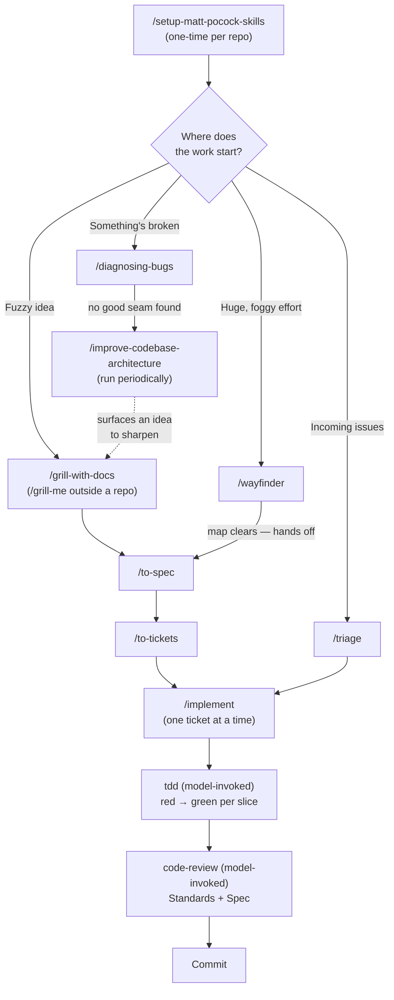
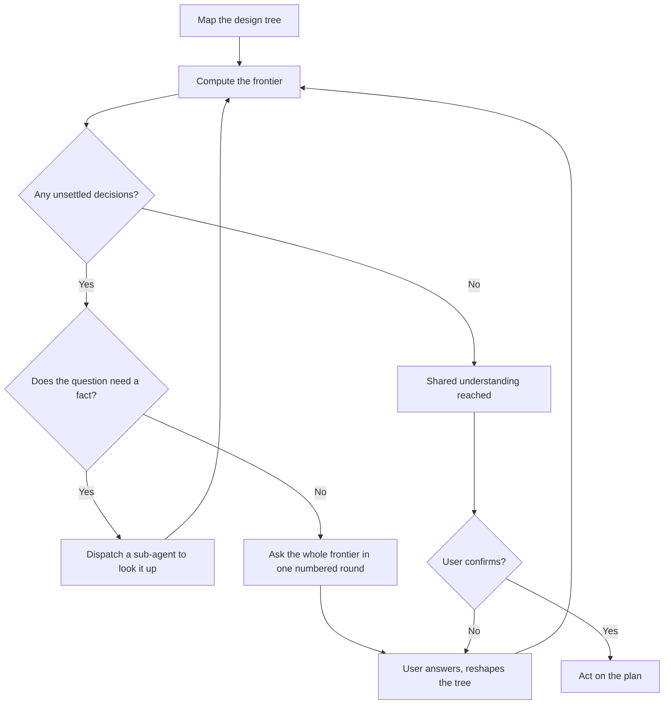
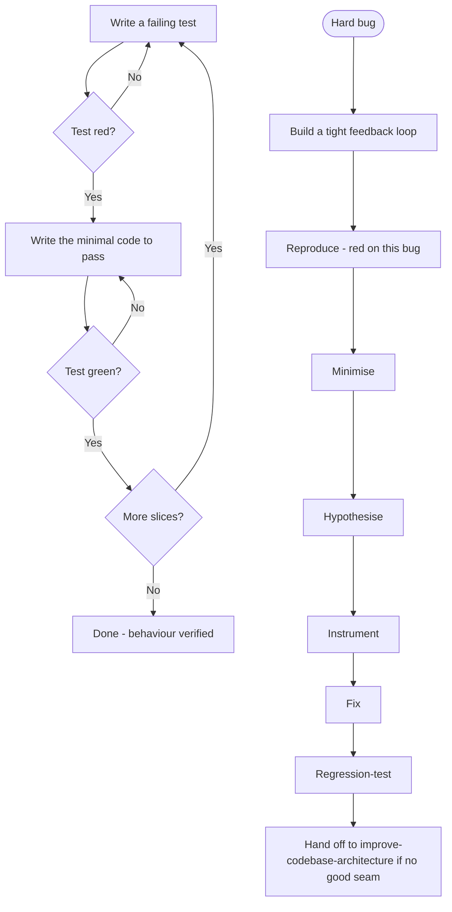
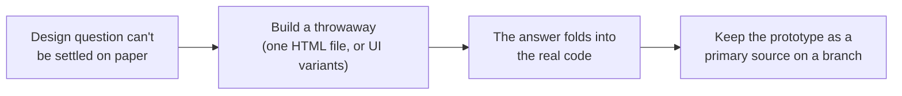
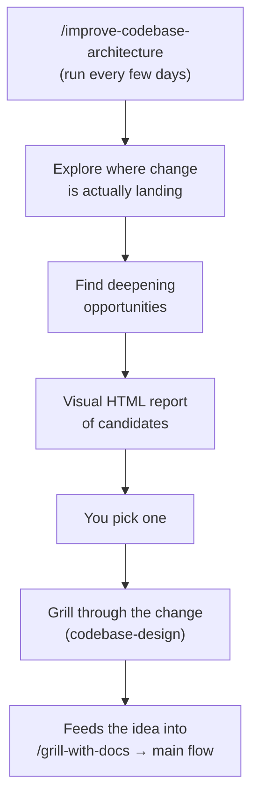
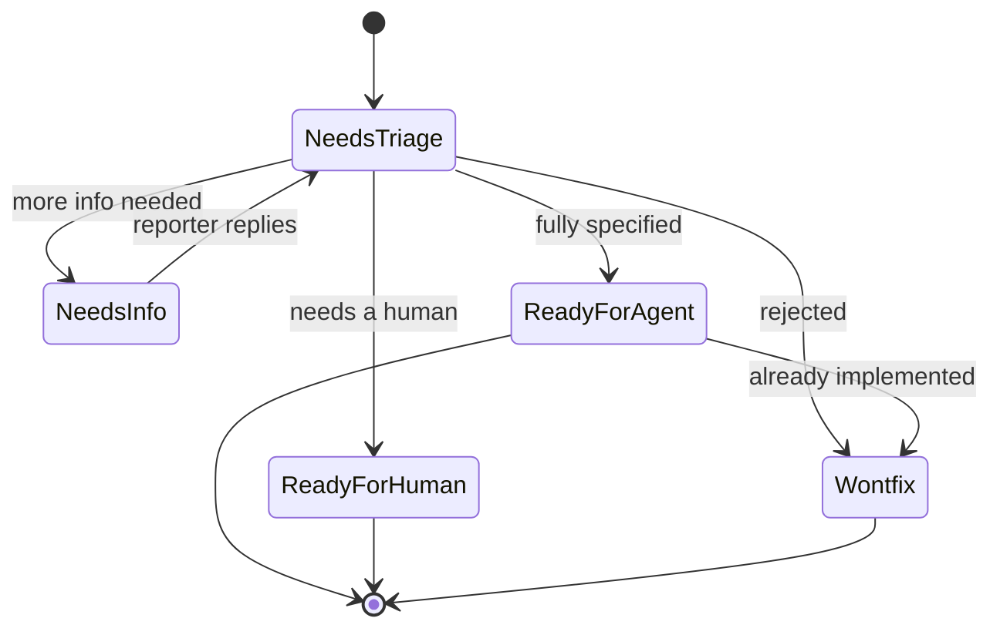
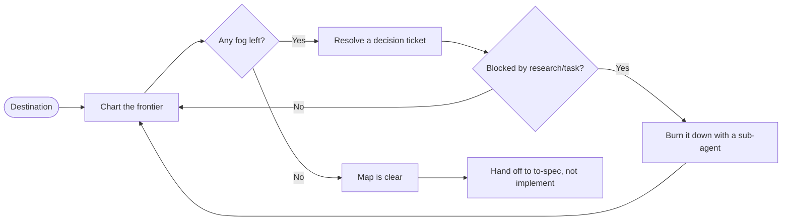
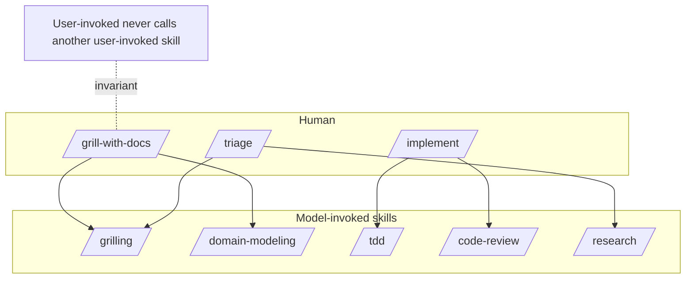
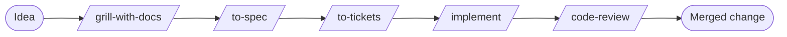

# Matt Pocock Skills v1.2.3 — Reference & Guide

A practical, developer-facing reference for using the **Matt Pocock** agent skill ecosystem for software design, documentation, and maintenance.

This guide is a *reference*, not a copy. It summarizes and explains the skills from the [`mattpocock/skills`](https://github.com/mattpocock/skills) repository (MIT licensed), created by Matt Pocock and published at [aihero.dev/skills](https://www.aihero.dev/skills). It leads with what you need to **get started and working quickly** — a cheat sheet, installation, and the core workflows — and defers the conceptual and reference material to later sections, so you can start moving fast and dive deeper when you need to.

> [!NOTE]
> This reference pins the **v1.2.3** release (published **2026-08-06**, commit `6acc160e`). Skills evolve; if you are on a newer version, check the [source repository](https://github.com/mattpocock/skills) and its `CHANGELOG.md` for changes. Deprecated and removed skills are excluded here by design.

## Table of Contents

- [Matt Pocock Skills v1.2.3 — Reference \& Guide](#matt-pocock-skills-v123--reference--guide)
  - [Table of Contents](#table-of-contents)
  - [1. Quick-reference cheat sheet](#1-quick-reference-cheat-sheet)
  - [2. Getting started](#2-getting-started)
    - [2.1 Install the skills](#21-install-the-skills)
      - [Managed installs (pick one)](#managed-installs-pick-one)
      - [Manual install (clone + copy)](#manual-install-clone--copy)
    - [2.2 Initialize the repo (`/setup-matt-pocock-skills`)](#22-initialize-the-repo-setup-matt-pocock-skills)
      - [What it decides](#what-it-decides)
      - [Which file it edits: CLAUDE.md vs AGENTS.md](#which-file-it-edits-claudemd-vs-agentsmd)
      - [What it writes](#what-it-writes)
    - [2.3 You're ready](#23-youre-ready)
  - [3. Common starting points](#3-common-starting-points)
  - [4. Workflows](#4-workflows)
    - [4.1 The complete lifecycle](#41-the-complete-lifecycle)
    - [4.2 The grilling / design-tree loop](#42-the-grilling--design-tree-loop)
    - [4.3 Feedback loops: `tdd`, `diagnosing-bugs`, and `prototype`](#43-feedback-loops-tdd-diagnosing-bugs-and-prototype)
    - [4.4 Keeping the codebase from becoming a ball of mud](#44-keeping-the-codebase-from-becoming-a-ball-of-mud)
    - [4.5 Handling a large backlog and big work](#45-handling-a-large-backlog-and-big-work)
      - [A growing backlog of incoming issues → `/triage`](#a-growing-backlog-of-incoming-issues--triage)
      - [A huge, foggy effort → `/wayfinder`](#a-huge-foggy-effort--wayfinder)
    - [4.6 How user-invoked and model-invoked skills relate](#46-how-user-invoked-and-model-invoked-skills-relate)
  - [5. Which skill when?](#5-which-skill-when)
    - [The main flow: idea → ship](#the-main-flow-idea--ship)
    - [When to reach for each skill](#when-to-reach-for-each-skill)
  - [6. The skills catalog](#6-the-skills-catalog)
    - [6.1 Engineering — user-invoked](#61-engineering--user-invoked)
    - [6.2 Engineering — model-invoked](#62-engineering--model-invoked)
    - [6.3 Productivity — user-invoked](#63-productivity--user-invoked)
    - [6.4 Productivity — model-invoked](#64-productivity--model-invoked)
  - [7. What is a skill?](#7-what-is-a-skill)
    - [User-invoked vs model-invoked](#user-invoked-vs-model-invoked)
  - [8. What problem is this solving?](#8-what-problem-is-this-solving)
    - [#1 — "The agent didn't do what I want"](#1--the-agent-didnt-do-what-i-want)
    - [#2 — "The agent is way too verbose"](#2--the-agent-is-way-too-verbose)
    - [#3 — "The code doesn't work"](#3--the-code-doesnt-work)
    - [#4 — "We built a ball of mud"](#4--we-built-a-ball-of-mud)
  - [9. Kinds of skills](#9-kinds-of-skills)
  - [10. Skill-dependency map](#10-skill-dependency-map)
  - [11. The `.scratch` directory (local-markdown tracker)](#11-the-scratch-directory-local-markdown-tracker)
      - [Layout](#layout)
      - [Conventions](#conventions)
      - [How skills use it](#how-skills-use-it)
      - [How you interact with it](#how-you-interact-with-it)
  - [12. Common mistakes](#12-common-mistakes)
    - [Over-reaching for `wayfinder`](#over-reaching-for-wayfinder)
    - [Losing the way at the wayfinder handoff](#losing-the-way-at-the-wayfinder-handoff)
    - [`/compact` vs `/handoff` — reaching for the wrong one](#compact-vs-handoff--reaching-for-the-wrong-one)
    - [A grilling agent answering its own questions](#a-grilling-agent-answering-its-own-questions)
    - [Testing at the wrong seam, or writing tautological tests](#testing-at-the-wrong-seam-or-writing-tautological-tests)
    - [Triaging your own tickets](#triaging-your-own-tickets)
  - [13. Practical summary](#13-practical-summary)
  - [14. Glossary of terms](#14-glossary-of-terms)
  - [15. Source, license \& attribution](#15-source-license--attribution)
    - [Influences \& further reading](#influences--further-reading)
  - [Footer](#footer)

---

## 1. Quick-reference cheat sheet

All **25 stable skills** in v1.2.3, in one table. *UI* = user-invoked (you type it). *MI* = model-invoked (the agent can reach for it automatically, or you can).

| Skill | Invocation | One-liner |
| ----- | :--------: | --------- |
| `ask-matt` | UI | Router: tells you which skill or flow fits your situation |
| `grill-with-docs` | UI | Interview you about a change while building the project's shared language (`CONTEXT.md` + ADRs) |
| `triage` | UI | Move incoming issues/PRs through a state machine of triage roles |
| `improve-codebase-architecture` | UI | Scan the codebase for deepening opportunities and pick one to work |
| `setup-matt-pocock-skills` | UI | Configure the repo (issue tracker, labels, doc layout) once |
| `to-spec` | UI | Turn the current conversation into a spec, published to the tracker |
| `to-tickets` | UI | Break a plan/spec/conversation into tracer-bullet tickets with blocking edges |
| `implement` | UI | Build the work a spec/tickets describe, driving `tdd` and `code-review` |
| `wayfinder` | UI | Plan a huge, multi-session effort as a map of decision tickets |
| `prototype` | MI | Throwaway code (a single HTML file, or UI variations) that answers a design question |
| `diagnosing-bugs` | MI | Disciplined loop for hard bugs and performance regressions |
| `research` | MI | Background agent investigates against primary sources, returns a cited Markdown file |
| `tdd` | MI | Red-green test-driven development, one vertical slice at a time |
| `domain-modeling` | MI | Actively build and sharpen the project's domain model / shared language |
| `codebase-design` | MI | Deep-module vocabulary for designing a module's shape |
| `code-review` | MI | Two-axis review of a diff (Standards + Spec) via parallel sub-agents |
| `resolving-merge-conflicts` | MI | Resolve an in-progress git merge/rebase conflict hunk by hunk by intent |
| `wizard` | MI | Generate an interactive bash wizard for steps only a human can take |
| `grill-me` | UI | The interview, stateless — for when you're not in a working directory |
| `handoff` | UI | Compact the conversation into a portable handoff doc for another agent |
| `teach` | UI | Teach you a concept over multiple sessions using a stateful workspace |
| `to-questionnaire` | UI | Write a questionnaire for someone else whose knowledge you need |
| `wait-what` | UI | Re-pitch the last message that didn't land, in plain English |
| `grilling` | MI | The reusable interview primitive (rounds, frontier, facts vs decisions) |
| `writing-for-agents` | MI | Reference for writing documents agents consume (skills, AGENTS.md) |

---

## 2. Getting started

### 2.1 Install the skills

Three ways in, two philosophies — **pick one**. The **Claude Code plugin** subscribes to the whole set as a managed, read-only bundle. **skills.sh** and **manual install** both give you editable files you own.

#### Managed installs (pick one)

| Path | Command | Philosophy |
| ---- | ------- | ---------- |
| **Claude Code plugin** (managed) | `claude plugins install mattpocock-skills`<br>or, in a session: `/plugin install mattpocock-skills` | Subscribe to the whole set as a read-only bundle. Updates arrive automatically when Matt ships. |
| **skills.sh** (editable files) | `npx skills@latest add mattpocock/skills` | Copy editable skill files into your repo. You own and can hack on them. Nothing updates behind your back; pull changes later with `npx skills update`. |

> [!WARNING]
> **Pick one.** Installing both leaves you with every skill twice.

The installer for the editable path lets you choose which skills to take — **make sure `setup-matt-pocock-skills` is one of them**. (For Codex specifically, use `npx skills@latest add mattpocock/skills` and select the skills you want.)

#### Manual install (clone + copy)

No installer needed: a skill is a plain folder with `SKILL.md` at its top level, so you can install by hand into any harness's skill directory. The stable skills live in `skills/engineering/<name>/` and `skills/productivity/<name>/` in the repo. Copy each skill **folder** (not just `SKILL.md`) so its `references/`, `scripts/`, and `agents/` support files travel with it.

```bash
git clone https://github.com/mattpocock/skills.git
cd skills
```

Then copy the skill folders you want into the directory your harness reads. **Claude Code** reads skills from `~/.claude/skills/` (global, all projects) or `<repo>/.claude/skills/` (that repo only):

```bash
# global (all your projects)
mkdir -p ~/.claude/skills
cp -R skills/engineering/grill-with-docs skills/productivity/grill-me ~/.claude/skills/

# repository-specific (just this project)
mkdir -p <repo>/.claude/skills
cp -R skills/engineering/* skills/productivity/* <repo>/.claude/skills/
```

**OpenCode** reads skills from `~/.config/opencode/skills/` (global, all projects) or `<repo>/.opencode/skills/` (that repo only):

```bash
# global (all your projects)
mkdir -p ~/.config/opencode/skills
cp -R skills/engineering/* skills/productivity/* ~/.config/opencode/skills/

# repository-specific (just this project)
mkdir -p <repo>/.opencode/skills
cp -R skills/engineering/* skills/productivity/* <repo>/.opencode/skills/
```

> [!TIP]
> The `engineering/*` and `productivity/*` globs also copy each bucket's `README.md`, which is harmless. If you prefer to stay current without re-copying, **symlink** the skill folders into the destination instead (e.g. `ln -s /path/to/skills/engineering/tdd ~/.claude/skills/tdd`); a `git pull` in your clone then updates every installed skill at once. Whichever way you install, **include `setup-matt-pocock-skills`** — the other engineering skills depend on it.

### 2.2 Initialize the repo (`/setup-matt-pocock-skills`)

Run `/setup-matt-pocock-skills` **once per repo**, before your first engineering flow. It configures the assumptions the other engineering skills depend on, then writes them into your agent-instruction file so every future session knows them.

#### What it decides

- **Issue tracker** — where issues live: GitHub (uses the `gh` CLI), GitLab (uses `glab`), **local markdown** (files under `.scratch/`, see [§11](#11-the-scratch-directory-local-markdown-tracker)), or "other" (you describe the workflow in prose, and the skill records it as freeform text).
- **Triage labels** — the strings used for the five canonical triage roles (`needs-triage`, `needs-info`, `ready-for-agent`, `ready-for-human`, `wontfix`). Asked only when the `triage` skill is installed; the default is to keep the canonical strings.
- **Domain docs** — **single-context** (one `CONTEXT.md` + `docs/adr/` at the root) by default; **multi-context** (`CONTEXT-MAP.md` + per-context `CONTEXT.md`) is offered only when the repo shows monorepo signals.

#### Which file it edits: CLAUDE.md vs AGENTS.md

The skill edits **exactly one** of your agent-instruction files:

- If `CLAUDE.md` exists, edit it.
- Else if `AGENTS.md` exists, edit it.
- If neither exists, it asks you which one to create.

It never creates `AGENTS.md` when `CLAUDE.md` already exists (or vice versa), and it updates an existing `## Agent skills` block **in place** rather than appending a duplicate.

#### What it writes

A `## Agent skills` block with three one-line pointers:

```markdown
## Agent skills

### Issue tracker
[one-line summary of where issues are tracked]. See `docs/agents/issue-tracker.md`.

### Triage labels
[one-line summary of the label vocabulary]. See `docs/agents/triage-labels.md`.

### Domain docs
[one-line summary of layout: "single-context" or "multi-context"]. See `docs/agents/domain.md`.
```

The `### Triage labels` sub-block (and its file) is only written when `triage` is installed. The skill also creates the referenced files under `docs/agents/`: `issue-tracker.md`, `domain.md`, and — if `triage` is installed — `triage-labels.md`. `CONTEXT.md` and ADRs are **not** created upfront: `domain-modeling` creates them lazily, as terms and decisions actually get resolved.

### 2.3 You're ready

That's it — 30 seconds. From here, the fastest on-ramps are in [§3 Common starting points](#3-common-starting-points), and the full flows are in [§4 Workflows](#4-workflows).

---

## 3. Common starting points

If you're new, start here. These four skills cover the most common things you'll do.

- **`ask-matt`** — *"I don't remember every skill, so ask."* This is the **router**. You don't need to memorize the catalog; describe your situation and it points you at the right skill or flow. It's the natural first stop when you're unsure. ([§5](#5-which-skill-when) mirrors its decision logic.)
- **`grill-with-docs`** — the flagship **interview** skill for when you're in a working directory. It sharpens your idea by asking detailed questions, *and* it builds the project's shared language along the way, recording what it learns in `CONTEXT.md` and ADRs. Matt calls this "possibly the single coolest technique in this repo." Use it *every time* you want to make a change.
- **`grill-me`** — the same interview, but **stateless**: it saves nothing and builds no `CONTEXT.md`. Use it when you're **not** in a working directory (a plan, a design, a piece of writing).
- **`wait-what`** — the corrective. The moment an agent's message doesn't land, type `/wait-what` and it re-pitches the message with the context you were missing, in plain English, using your `CONTEXT.md` vocabulary.

> [!TIP]
> **In a working directory → use `grill-with-docs`** (it leaves a paper trail, so it's strictly better). **No working directory → use `grill-me`.** Both run the same underlying `grilling` primitive.

---

## 4. Workflows

The value of this ecosystem comes from **composing** skills into flows. Each subsection below pairs a workflow with a Mermaid diagram and explains how it fits together.


### 4.1 The complete lifecycle

The most common path from a loose idea to a committed change, showing the four on-ramps, the model-invoked sub-steps `/implement` drives, and the periodic architecture survey.



Most work starts one of four ways — a fuzzy idea, a pile of incoming issues, a broken thing, or a huge foggy effort — and every path funnels into the same build machinery: `grill-with-docs → to-spec → to-tickets → implement`, with `/implement` driving `tdd` (red → green) and closing out with `code-review` before you commit.

For a change small enough to fit one session, skip the spec/tickets steps and go `idea → /implement` directly. `tdd` is red → green here — in v1.2.3, refactoring belongs to `code-review`, not the TDD loop.

### 4.2 The grilling / design-tree loop

The single most important habit in this ecosystem is to **align with the agent before it builds anything** — and that's what grilling is for. It's why every major flow starts with an interview rather than code. `grilling` is the reusable interview primitive behind `grill-me`, `grill-with-docs`, `triage`, `wayfinder`, and `improve-codebase-architecture`.

**How it works:**

- A grilling session maps your goal as a **design tree**: every decision branches into the decisions that hang off it.
- It works the tree in **rounds**. Each round asks the whole **frontier** — every question whose prerequisites are already settled — in one numbered list, each with a recommended answer. You answer by number.
- **Facts are the agent's job; decisions are yours.** When a question needs a fact from the environment (filesystem, tools), the agent dispatches a sub-agent to find it rather than asking you. Only the *decisions* are put to you.
- The session ends when the **frontier is empty** — every branch visited, nothing silently assumed — and you confirm you've reached shared understanding.



**Why it matters:** most software failures are misalignment. Grilling front-loads the questioning so the agent doesn't discover it misunderstood you after building the wrong thing. And with `grill-with-docs`, the interview *also* builds the shared language (`CONTEXT.md`) and records hard decisions as ADRs — so the alignment persists across sessions, not just this one.

> [!TIP]
> **The confirmation gate.** Grilling won't enact the plan until *you* confirm the shared understanding has been reached. If an agent "grills" and then answers its own questions and races ahead, that's a broken HITL (human-in-the-loop) — call it out.

### 4.3 Feedback loops: `tdd`, `diagnosing-bugs`, and `prototype`

Feedback is the "speed limit" of agentic coding: it tells the agent quickly whether its change actually works, instead of letting errors accumulate silently. Three skills build feedback loops:

- **`tdd`** — Red-green TDD. Write a failing test, make it pass, repeat one vertical slice at a time. Tests give the agent consistent feedback and anchor behaviour. The "expected values must come from an independent source of truth" rule guards against tautological tests (tests that pass by construction and give zero confidence).
- **`diagnosing-bugs`** — The debugging loop. It refuses to theorize until it has a tight feedback loop (one command already red on *this* bug), then works reproduce → minimise → hypothesise → instrument → fix → regression-test, gated phase by phase. Secrets are redacted from shown commands and outputs.
- **`prototype`** — A different kind of feedback: when a design question (state model, business logic, a UI you must see) can't be answered by thinking, build a throwaway that answers it. The answer folds into the real code; the prototype is kept as a primary source on a throwaway branch.

The `tdd` and `diagnosing-bugs` loops, diagrammed together:



**The `prototype` flow** — linear, not a loop:



The theme (from *The Pragmatic Programmer*): *"The rate of feedback is your speed limit."* Static types, browser access, and automated tests are the usual tranche of feedback loops — TDD is the one that gives the agent a *consistent* level.

### 4.4 Keeping the codebase from becoming a ball of mud

Because agents can radically speed up coding, they also accelerate software entropy. The countermeasure is built into several skills working together:

- **`codebase-design`** — The deep-module discipline. *"The best modules are deep. They allow a lot of functionality to be accessed through a simple interface."* (Ousterhout). It gives you the vocabulary — module, interface, depth, seam, adapter — to put a lot of behaviour behind a small interface at a clean seam, testable through that interface. It includes the "design it twice" technique (parallel sub-agents generating radically different designs).
- **`domain-modeling`** — The shared-language discipline. A project with a precise, consistent vocabulary is dramatically easier for an agent (and a human) to navigate. It keeps `CONTEXT.md` a clean glossary and records hard-to-reverse decisions as ADRs.
- **`improve-codebase-architecture`** — The regular survey. Run it "once every few days" (as Matt recommends) to find deepening opportunities in the areas where change is actually landing. It's a **survey, not a rescue**: on a genuinely old codebase it finds candidates, but it won't untangle the mud for you.
- **`grill-with-docs`** — The preventive. By building the shared language up front, it keeps the codebase from drifting into jargon soup in the first place.

The architecture-survey loop:



> [!IMPORTANT]
> A shared language pays off repeatedly: **variables, functions and files are named consistently; the codebase is easier to navigate; and the agent spends fewer tokens on thinking** because it has a more concise language to reason in.

### 4.5 Handling a large backlog and big work

Two very different problems, two skills (plus their helpers).

**Triage** moves incoming issues through a state machine of roles until they become agent-ready. **Wayfinder** charts a huge, foggy effort as a map of **decision tickets** on the issue tracker, resolved one at a time until the way is clear.

#### A growing backlog of incoming issues → `/triage`

Incoming issues (and external PRs, when configured) flow through a state machine:

1. **Gather context** — read the full issue/PR, run a *redundancy* check (is it already implemented?) and a *prior-rejection* check (`.out-of-scope/`).
2. **Recommend** a category (`bug` / `enhancement`) and a state (`needs-triage` / `needs-info` / `ready-for-agent` / `ready-for-human` / `wontfix`).
3. **Verify the claim** — reproduce a bug, or confirm a PR's diff does what it claims.
4. **Grill if needed** — flesh out a fuzzy request, sharpening domain terms.
5. **Apply the outcome** — write an agent brief for `ready-for-agent` / `ready-for-human`, post triage notes for `needs-info`, close for `wontfix` (with the reason-dependent handling).

A quick state override is available: "move #42 to ready-for-agent" is trusted and applied directly, skipping grilling.

The triage state machine (an issue carries exactly one *category* and one *state* role):



#### A huge, foggy effort → `/wayfinder`

For work too big to hold in one session, wayfinder charts a route through the fog:

- It names a **destination** (the first act of charting).
- It produces **decisions, not deliverables** — a map of **decision tickets** on the issue tracker.
- It tracks the **frontier**: tickets whose blockers are done are takeable; blocking prefers the tracker's native dependency links.
- It classifies tickets as **HITL** (grilling, prototype — need the live human) or **AFK** (research — an agent alone).
- When the fog clears, **it hands off**: merge onto the main flow at `/to-spec`, which collapses the linked decisions into a buildable plan. Don't loop the map straight into `/implement` (that throws the linked detail away) — unless the effort turned out genuinely small.

The wayfinder map (decisions, not deliverables):



**Phase boundaries** (from `ask-matt`) govern the glue between chunks: at a boundary you have five options — **Continue** (default), `/clear`, `/handoff`, **subagent**, or `/compact`. Make the choice *at* a boundary, not mid-phase. (See [§12](#12-common-mistakes) for the `/compact` vs `/handoff` distinction.)

### 4.6 How user-invoked and model-invoked skills relate

The relationship is a strict one-way orchestration, and the invariant is what keeps the system predictable:

> **A user-invoked skill may invoke model-invoked skills, but it can never invoke another user-invoked skill.** Only the human can fire a user-invoked skill.

Consequences of this design:

- **User-invoked skills orchestrate; model-invoked skills hold reusable discipline.** The user-invoked skill is the conductor; the model-invoked skills are the sections it calls on.
- **A model-invoked skill's dependencies are expressed as explicit "call the Skill tool" instructions** (e.g. `Call the Skill tool with "grilling"`), not as deep cross-file references — this is what gets the skill actually fired.
- **When a step's precondition is a user-invoked skill** (e.g. `setup-matt-pocock-skills`), it can't be called by another skill, so it's phrased as an instruction for the *human*: "tell the user to run `/setup-matt-pocock-skills`".
- **A user-invoked skill's description is human-facing** (a one-line summary for a person browsing commands); **a model-invoked skill's description is model-facing** (rich trigger phrasing so auto-invocation fires).



The test for whether a skill *should* be model-invoked: *could the model usefully reach for this autonomously?* If yes, it's model-invoked; if only you should ever start it, it's user-invoked.

---

## 5. Which skill when?

The `ask-matt` router organizes the ecosystem into a **main flow** plus **on-ramps** that merge onto it, a **codebase-health** track, and a **vocabulary** layer that runs beneath everything. This decision guide summarizes it.

### The main flow: idea → ship

Most work travels this route — the linear spine every build runs down:



### When to reach for each skill

| Situation | Skill(s) |
| --------- | -------- |
| Not sure which skill/flow fits | `ask-matt` |
| You have an idea and want it built, in a working directory | `grill-with-docs` |
| Sharpening a plan/writing, **no** working directory | `grill-me` |
| You need the interview with no wrapper | `grilling` |
| A question needs a runnable answer (state, logic, a UI you must see) | `handoff` + `prototype` |
| The build is bigger than one session | `to-spec` → `to-tickets` → `implement` (per ticket) |
| The build fits in one session | `implement` directly |
| You just want one behaviour built test-first | `tdd` |
| You want a branch/PR reviewed against a fixed point | `code-review` |
| Bugs and requests are piling up (issues you didn't create) | `triage` |
| Something's broken (a hard bug, an intermittent flake, a regression) | `diagnosing-bugs` |
| A huge, foggy effort — greenfield or too big for one session | `wayfinder` |
| Spare moment to keep the codebase good for agents | `improve-codebase-architecture` |
| The *words* are the problem (fuzzy/overloaded domain terms) | `domain-modeling` |
| The *shape* of a module is the problem (deep module design) | `codebase-design` |
| You're already mid merge/rebase conflict | `resolving-merge-conflicts` |
| Delegating reading legwork to a background agent | `research` |
| You need someone else's knowledge, async | `to-questionnaire` |
| A step only a human can perform (creds, dashboards, migrations) | `wizard` |
| An agent message didn't land | `wait-what` |
| Learning a concept over several sessions | `teach` |
| Moving work to a new harness/directory/colleague | `handoff` |
| Writing a skill or AGENTS.md | `writing-for-agents` |

---

## 6. The skills catalog

Each skill is listed with **what it does** and **when to use it**. The four buckets match the [grid in §9](#9-kinds-of-skills); each table's heading states the invocation type (user-invoked or model-invoked).

### 6.1 Engineering — user-invoked

| Skill | What it does | Use when |
| ----- | ------------ | -------- |
| `ask-matt` | A router over the user-invoked skills. It reads your situation and tells you which skill or flow fits, covering the main flow, the on-ramps, codebase health, the vocabulary layer, and phase boundaries. | You don't remember every skill, or you're not sure where to start. |
| `grill-with-docs` | The interview that also builds your project's domain model. It sharpens terminology and updates `CONTEXT.md` and ADRs inline as decisions land. It's the better of the two grills whenever a repo is present. | You're in a working directory and want to make a change, and you want a paper trail of the thinking. |
| `triage` | Moves incoming issues (and external PRs, when configured) through a small state machine of triage roles: two categories (`bug`, `enhancement`) and five states (`needs-triage`, `needs-info`, `ready-for-agent`, `ready-for-human`, `wontfix`). It gathers context, recommends, verifies claims, grills if needed, and writes agent-ready briefs. | Bugs and requests you didn't create are piling up. Don't triage tickets `/to-tickets` produced — those are already agent-ready. |
| `improve-codebase-architecture` | Surveys the codebase for **deepening opportunities** and hands you the candidates as a visual HTML report; you pick one and it grills through it. The Explore step scopes to where change is actually landing (last ~20 commit messages) rather than tidying dormant corners. It's a **survey, not a rescue**. | You have a spare moment to keep the codebase good for agents. |
| `setup-matt-pocock-skills` | Configures the repo for the engineering skills: issue tracker, triage labels, and domain-doc layout. | Once per repo, before your first engineering flow. |
| `to-spec` | Turns the current conversation into a **spec** and publishes it to the issue tracker. No interview — it synthesizes what you've already discussed. | You've grilled an idea and want it captured as a durable spec. |
| `to-tickets` | Breaks a plan, spec, or conversation into a set of **tracer-bullet tickets**, each declaring its **blocking edges**. On a local tracker these are one file per ticket, worked blockers-first; on a real tracker the edges become native blocking links so any ticket whose blockers are done can be grabbed. | A spec is too big for one slice and needs splitting into parallelizable units. |
| `implement` | Builds the work a spec or set of tickets describes, driving `/tdd` at pre-agreed seams and closing out with `/code-review` before committing. | You have tickets to build. Each ticket is self-contained, so you can `/clear` context between them. |
| `wayfinder` | Plans a huge chunk of work (more than one agent session can hold) as a shared map of **decision tickets** on the issue tracker, resolved one at a time until the way to the destination is clear. | A greenfield project or huge feature build is too big for one session. When the map clears, it **hands off** — merge onto the main flow at `/to-spec`. |

### 6.2 Engineering — model-invoked

| Skill | What it does | Use when |
| ----- | ------------ | -------- |
| `prototype` | Builds a throwaway program that answers one design question: either a single shareable HTML file (for state/logic questions) or several radically different UI variations toggleable from one route. Throwaway means *how the code is written*, not *delete it*: the answer folds into the real code and the prototype is kept as a primary source on a `prototype/<name>` branch. | A design question is hard to settle on paper. |
| `diagnosing-bugs` | A disciplined loop for hard bugs and performance regressions: build a feedback loop that goes red on *this* bug → reproduce → minimise → hypothesise → instrument → fix → regression-test. It now also **redacts secrets** from shown commands/outputs. | The bug resists a first glance, an intermittent flake, or a regression between two known-good states. |
| `research` | Spins up a **background agent** to investigate a question against **primary sources** (official docs, source, specs, first-party APIs) and leaves a single cited Markdown file wherever the repo keeps such notes. | You want to delegate reading legwork while you keep working. |
| `tdd` | Test-driven development with a red-green loop, building features or fixing bugs one vertical slice at a time, testing only at pre-agreed **seams**. A reference-only skill; it leans on `codebase-design` for interface guidance. | You want to build a concrete behaviour test-first without a full spec. |
| `domain-modeling` | Actively builds and sharpens the project's domain model: challenges terms against the glossary, stress-tests with edge-case scenarios, and updates `CONTEXT.md` and ADRs inline. | The *words* are the problem — a fuzzy term, an overloaded word doing three jobs, or a hard-to-reverse decision worth an ADR. |
| `codebase-design` | The deep-module vocabulary (module, interface, depth, seam, adapter) for designing a module's shape: a lot of behaviour behind a small interface at a clean seam, testable through that interface. | The *shape* of a module is the problem. |
| `code-review` | A two-axis review of the diff since a fixed point: **Standards** (repo coding standards + a Fowler smell baseline) and **Spec** (does it faithfully implement the originating issue/spec?), run as parallel sub-agents so neither pollutes the other. | Reviewing a branch/PR, or as the closing step of `/implement`. |
| `resolving-merge-conflicts` | Works an in-progress git merge/rebase conflict hunk by hunk, resolving **by intent** traced to each side's primary source, then finishes the operation — never `--abort`. | You're already mid-conflict. |
| `wizard` | Generates an interactive bash wizard that walks a human through steps only they can perform: provisioning infrastructure, credentials/CI secrets, unfamiliar third-party dashboards, one-off migrations or cutovers. The agent reaches for it the moment it hits a wall only you can pass. | A step needs a human in the loop — not for anything the agent can do itself. |

### 6.3 Productivity — user-invoked

| Skill | What it does | Use when |
| ----- | ------------ | -------- |
| `grill-me` | The relentless interview, stateless: it saves nothing and builds no `CONTEXT.md`. | You are **not** in a working directory (a plan, a design, a piece of writing). In a working directory, prefer `grill-with-docs`. |
| `handoff` | Compacts the current conversation into a portable handoff document so another agent can continue the work. It's narrow — for when something must travel. | Something must **travel** — a new harness, a new directory, a colleague, or a side task forked mid-phase. Don't reach for it as the general bridge between sessions (see [§12](#12-common-mistakes)). |
| `teach` | Teaches the user a new skill or concept over multiple sessions, using the current directory as a stateful teaching workspace, built from reusable components. | You want to genuinely learn a concept, not just be handed a summary. |
| `to-questionnaire` | Turns a decision you can't answer alone into a Markdown questionnaire for the one person who can, filled in async or over a meeting. It grills you about the **send** (who it's for, what you need back), not the subject. | The blocker is in someone else's head, not yours or the codebase's. |
| `wait-what` | A one-word corrective for a message that didn't land. The agent re-pitches it with the context you're missing, in plain English, using your `CONTEXT.md` vocabulary. | Mid-conversation, inside any skill, the moment a message doesn't land. |

### 6.4 Productivity — model-invoked

| Skill | What it does | Use when |
| ----- | ------------ | -------- |
| `grilling` | The reusable interview primitive: it maps a design tree and asks the whole **frontier** in numbered rounds, dispatching fact-finding to sub-agents and putting every *decision* to you, stopping only when the frontier is empty and you confirm. | You want the interview with no wrapper around it — or, implicitly, whenever another skill runs it (see [§4.2](#42-the-grilling--design-tree-loop)). |
| `writing-for-agents` | The reference for writing documents agents consume: skills, `AGENTS.md`/`CLAUDE.md`, and any doc an agent reaches by a pointer. (Renamed from `writing-great-skills` in v1.2.0; reinstall under the new name.) | Creating or editing a skill or an agent-facing doc. |

---

## 7. What is a skill?

**A skill is a small bundle of instructions that an AI coding agent loads to do a specific kind of job well.** Think of it as a reusable, curated "job description" for the agent. Where a normal chat gives the agent a vague goal, a skill gives it a precise method — the same disciplined procedure an experienced engineer would follow.

Technically, a skill lives in a folder with a `SKILL.md` file at its heart. That file carries:

- **Frontmatter** — YAML metadata (name, description, whether it's user- or model-invoked).
- **Instructions** — the body: what the skill is for, how to run it, what "done" looks like, pitfalls to avoid.

The skills in this repo are deliberately **small, composable, and easy to adapt**. They are designed to work with any model and any harness (Claude Code, OpenCode, and others). They are not monolithic "do everything" frameworks — you compose several together to form a **flow** (see [§4 Workflows](#4-workflows)).

### User-invoked vs model-invoked

The single most important distinction in this ecosystem is **who can reach the skill**:

| | User-invoked | Model-invoked |
| --- | ----------- | ------------- |
| **Reachable by** | Only you, by typing its name (e.g. `/grill-me`) | The model *or* you |
| **When it fires** | Only when you invoke it | Automatically when the task fits, or when you call it |
| **Its job** | **Orchestrate** — run a workflow, drive the session | Hold **reusable discipline** — a technique the agent applies |
| **Frontmatter flag** | `disable-model-invocation: true` | omitted (the default) |

The reasoning is simple: a user-invoked skill's *description* is written for a **human** browsing slash-commands (a one-line summary). A model-invoked skill's *description* is written for the **model** and keeps rich trigger phrasing ("Use when the user wants…, mentions…, asks for…") so the agent recognizes when to use it.

> [!IMPORTANT]
> **One rule governs everything:** a user-invoked skill may invoke model-invoked skills, but it can **never** reach another user-invoked skill. Only the human can fire a user-invoked skill. (More in [§4.6](#46-how-user-invoked-and-model-invoked-skills-relate).)

---

## 8. What problem is this solving?

Matt built these skills to fix the common failure modes people hit with AI coding agents. Each failure mode maps to a specific fix — and most of the "why" of this ecosystem is contained in these four pairings.

### #1 — "The agent didn't do what I want"

> "No-one knows exactly what they want"
> — David Thomas & Andrew Hunt, *The Pragmatic Programmer*

The most common failure is **misalignment**: you and the agent don't share an understanding of what you're building, and you only discover that when you see the result. **The fix is a *grilling* session** — the agent asks you detailed questions before building, so it aligns with you up front.

### #2 — "The agent is way too verbose"

> "With a ubiquitous language, conversations among developers and expressions of the code are all derived from the same domain model."
> — Eric Evans, *Domain-Driven Design*

Agents drop into a project and invent their own jargon, using 20 words where 1 will do. **The fix is a shared language** — a document (`CONTEXT.md`) that helps the agent decode the project's terms. This pays off repeatedly: files and functions get named consistently, the codebase is easier to navigate, and the agent spends fewer tokens on thinking.

### #3 — "The code doesn't work"

> "Always take small, deliberate steps. The rate of feedback is your speed limit."
> — David Thomas & Andrew Hunt, *The Pragmatic Programmer*

Even when aligned, the agent can produce code that doesn't work. **The fix is feedback loops** — static types, browser access, and automated tests. A **red-green-refactor** loop (write a failing test, then make it pass) gives the agent consistent feedback and produces far better code.

### #4 — "We built a ball of mud"

> "Invest in the design of the system *every day*."
> — Kent Beck, *Extreme Programming Explained*

> "The best modules are deep. They allow a lot of functionality to be accessed through a simple interface."
> — John Ousterhout, *A Philosophy Of Software Design*

Agents radically speed up coding — which also accelerates **software entropy**. **The fix is caring about design**: deep modules, a shared domain language, and regular architecture surveys to find "deepening" opportunities before the mud hardens.

---

## 9. Kinds of skills

The stable set is grouped along **two independent axes**. Every skill belongs to one cell of this grid:

| | Engineering | Productivity |
| --- | --- | --- |
| **User-invoked** | `ask-matt`, `grill-with-docs`, `triage`, `improve-codebase-architecture`, `setup-matt-pocock-skills`, `to-spec`, `to-tickets`, `implement`, `wayfinder` | `grill-me`, `handoff`, `teach`, `to-questionnaire`, `wait-what` |
| **Model-invoked** | `prototype`, `diagnosing-bugs`, `research`, `tdd`, `domain-modeling`, `codebase-design`, `code-review`, `resolving-merge-conflicts`, `wizard` | `grilling`, `writing-for-agents` |

**Engineering skills** are for code work — designing, building, reviewing, debugging, and maintaining software. **Productivity skills** are general workflow tools that aren't code-specific — interviewing, teaching, handing off work, clarifying communication.

The **user-invoked / model-invoked** split is covered in [§7](#7-what-is-a-skill) and [§4.6](#46-how-user-invoked-and-model-invoked-skills-relate). The two axes combine: the orchestration skills (user-invoked) live mostly in Engineering because shipping software is the primary flow; the reusable disciplines (model-invoked) underpin both buckets.

---

## 10. Skill-dependency map

User-invoked skills **drive** model-invoked skills. This table captures the wiring (from the source README, `ask-matt`, and the skill bodies). It's the "who calls whom" map for the ecosystem.

| User-invoked skill | Model-invoked skills it drives |
| ------------------ | ------------------------------ |
| `grill-with-docs` | `grilling`, `domain-modeling` |
| `grill-me` | `grilling` |
| `triage` | `grilling`, `domain-modeling` (only if grilling is needed) |
| `wayfinder` | `grilling`, `research` (to burn down research tickets) |
| `improve-codebase-architecture` | `grilling`, `codebase-design`, `domain-modeling` |
| `implement` | `tdd`, `code-review` |
| `tdd` (MI) | `codebase-design` (for interface guidance) |

Shared/reference skills that run *underneath* others:

- **`grilling`** — beneath `grill-me`, `grill-with-docs`, `triage`, `wayfinder`, and `improve-codebase-architecture`.
- **`domain-modeling`** — beneath `grill-with-docs` (and `improve-codebase-architecture`).
- **`codebase-design`** — spoken by `tdd` and `improve-codebase-architecture`.

---

## 11. The `.scratch` directory (local-markdown tracker)

If you chose **local markdown** as your issue tracker in [§2.2](#22-initialize-the-repo-setup-matt-pocock-skills), `.scratch/` at the repo root is where the engineering skills keep their working files. It's a plain directory of markdown files — best for solo projects or repos without a remote.

#### Layout

```text
.scratch/
└── <feature-slug>/
    ├── spec.md                 # from /to-spec
    └── issues/
        ├── 01-<slug>.md        # one file per ticket, numbered from 01
        ├── 02-<slug>.md
        └── ...
```

For `/wayfinder`, the map lives at `.scratch/<effort>/map.md` with one child ticket file per decision under `issues/`.

#### Conventions

- One feature per directory: `.scratch/<feature-slug>/`
- The spec is `.scratch/<feature-slug>/spec.md`
- Implementation tickets are one file per ticket at `.scratch/<feature-slug>/issues/<NN>-<slug>.md`, numbered from `01` — never a single combined tickets file
- Triage state is recorded as a `Status:` line near the top of each issue file
- Comments and conversation history append to the bottom under a `## Comments` heading

A ticket file follows the `/to-tickets` template:

```markdown
# 01: <Ticket title>

**What to build:** the end-to-end behaviour this ticket makes work, from the user's perspective.

**Blocked by:** None (can start immediately).

**Status:** ready-for-agent

- [ ] Acceptance criterion 1
- [ ] Acceptance criterion 2
```

Wayfinder child tickets add a `Type:` line (`research` / `prototype` / `grilling` / `task`) and track claim with `Status: claimed` / `Status: resolved`.

#### How skills use it

- **"Publish to the issue tracker"** → create a new file under `.scratch/<feature-slug>/` (creating the directory if needed).
- **"Fetch the relevant ticket"** → read the file at the referenced path (the user normally passes the path or issue number).

#### How you interact with it

- **Work the frontier** — any ticket whose blockers are all done is takeable; for a purely linear chain that means top to bottom.
- **For wayfinder:** claim a ticket by setting `Status: claimed` before any work; when resolved, append the answer under an `## Answer` heading, set `Status: resolved`, and add a context pointer to the map's "Decisions-so-far" section.
- **Manage it like any working directory** — the skills read and write it purely by convention. You can archive or delete a `<feature-slug>` directory once its feature ships; nothing else depends on it.

---

## 12. Common mistakes

These are the recurring mistakes the ecosystem's changelog and docs warn about most. Knowing them will save you time.

### Over-reaching for `wayfinder`

`wayfinder` is the heaviest, most cognitively demanding flow — slower and denser than a single grill. **Reserve it for the idea that genuinely won't fit one session.** A well-scoped feature belongs on `/grill-with-docs`, not wayfinder.

### Losing the way at the wayfinder handoff

When the map clears, wayfinder **hands off, it doesn't build**. Merge onto the main flow at `/to-spec` (which collapses the map's linked decisions into a buildable plan), *then* `/to-tickets` and `/implement`. Looping the map straight into `/implement` throws the linked detail away. Straight-to-`/implement` is only for efforts that turned out genuinely small.

### `/compact` vs `/handoff` — reaching for the wrong one

- **`/compact` is the default** at a phase boundary in the same harness and directory. It compresses the context and seeds a fresh session. Don't reach for `/handoff` first — starting with `/handoff` produces a session that's "confidently wrong about whatever the summary flattened."
- **`/handoff` is narrow.** You need it only when something must *travel*: a new harness, a new directory, a colleague, or a side task forked mid-phase. What it buys is portability.
- **`Continue` is the one to rule out first** — it's the only move that keeps the conversation as a primary source rather than a summary of one.

### A grilling agent answering its own questions

A HITL (human-in-the-loop) ticket — grilling, prototype — only resolves through the *live exchange* with you. If an agent grills itself instead of the human, it has broken HITL by definition. Facts are its job; **decisions are yours.**

### Testing at the wrong seam, or writing tautological tests

`tdd` tests only at **pre-agreed seams** (confirmed with you before any test is written), and its expected values must come from an **independent source of truth**. A test whose assertion is recomputed the way the code computes it passes by construction and gives zero confidence — watch for that.

### Triaging your own tickets

`/triage` is for issues you **didn't create** (bug reports, incoming feature requests). Tickets that `/to-tickets` produced are already agent-ready — **don't triage them.**

---

## 13. Practical summary

If you remember nothing else from this reference:

1. **Set up once** — run `/setup-matt-pocock-skills` before anything else.
2. **Never start coding on a vague idea** — grill it first: `/grill-with-docs` in a working directory, `/grill-me` outside one.
3. **Turn agreement into a spec and tickets** — `/to-spec` then `/to-tickets` — *unless* the change fits one session, in which case `/implement` directly.
4. **Build with `/implement`** — it drives TDD (red → green) and closes with `code-review` before committing.
5. **Revisit architecture periodically, not reactively** — run `/improve-codebase-architecture` every few days.
6. **Many small incoming issues** → `/triage`; **one huge, foggy effort** → `/wayfinder`.

---

## 14. Glossary of terms

| Term | Meaning |
| ---- | ------- |
| **Agentic software development** | Development where an AI agent autonomously carries out multi-step coding tasks (writing code, running tests, fixing errors) toward a goal, rather than you writing every line and running every command yourself. |
| **Skill** | A structured instruction file (`SKILL.md`) that teaches a coding agent a specific, repeatable process. Analogous to a documented team runbook, but written so an LLM can follow it. |
| **Frontmatter** | The YAML metadata at the top of a `SKILL.md` (name, description, invocation flags). |
| **User-invoked skill** | A skill you trigger explicitly with a command (e.g. `/grill-me`). Acts as an orchestrator/workflow. |
| **Model-invoked skill** | A skill the agent can reach for on its own when the task fits, or that you can call directly. Encodes a reusable technique rather than a whole workflow. |
| **Flow** | A path through the skills, composed by chaining them (e.g. idea → ship). |
| **Main flow** | The primary route: `grill-with-docs → to-spec → to-tickets → implement → code-review`. |
| **On-ramp** | A starting situation that generates work and merges onto the main flow (`triage`, `diagnosing-bugs`, `wayfinder`). |
| **Grilling / grilling session** | A structured interview where the agent asks you repeated clarifying questions until a plan has no remaining ambiguity, before any code is written. It maps the goal as a design tree and works it in rounds. |
| **Design tree** | The branching map of every decision in a goal and the decisions that hang off it. |
| **Frontier** | Every decision whose prerequisites are already settled — the questions you can ask now. |
| **Facts vs decisions** | Facts are the agent's job to look up; decisions are the human's to make. |
| **Spec** | A written specification of what should be built, generated from a conversation or grilling session, published to an issue tracker (formerly "PRD"). |
| **Tracer-bullet ticket** | A small, ordered unit of work, explicitly declaring which other tickets block it — designed to be implementable end-to-end rather than a vague chunk of a larger feature. |
| **Vertical slice** | A piece of functionality implemented end-to-end (e.g. UI → logic → data), however thin, rather than one architectural layer at a time. |
| **Blocking edges** | The declared dependencies between tickets; a ticket whose blockers are done is on the frontier. |
| **Decision ticket** | A wayfinder ticket whose resolution is a decision, not a deliverable. |
| **Fog / fog of war** | The unknown parts of a huge effort that wayfinder charts a route through. |
| **HITL** | Human-in-the-loop — a ticket/skill that only resolves through live human exchange (grilling, prototype). |
| **AFK** | Away-from-keyboard — a ticket/skill an agent can do alone (research). |
| **Sub-agent** | A separate agent instance spun up to do one focused piece of work (e.g. one axis of a code review) in isolation, so its output isn't biased by unrelated context. |
| **Background agent** | An agent task (like `research`) that runs independently while you continue other work, rather than blocking the conversation. |
| **Feedback loop** | Any mechanism (tests, type-checking, browser access, linting) that tells the agent quickly whether its change actually works, rather than letting errors accumulate silently. |
| **Red-green-refactor** | The core TDD cycle: write a failing test (red), write the minimum code to pass it (green), then clean up the implementation (refactor) — repeated per small slice of behaviour. |
| **Deep module** | A design principle (from John Ousterhout's *A Philosophy of Software Design*): a component that exposes a small, simple interface while hiding substantial functionality behind it — as opposed to a "shallow" module whose interface is nearly as complex as its implementation. |
| **Seam** | A clean boundary where a module can be tested through its interface. |
| **Domain model** | The shared, precise vocabulary of the project, maintained in `CONTEXT.md`. |
| **`CONTEXT.md`** | A living document capturing your project's domain-specific vocabulary ("ubiquitous language"), so agents don't have to re-derive it from scratch each session. Built by `grill-with-docs` / `domain-modeling`. |
| **Ubiquitous language** | A Domain-Driven Design concept (Eric Evans): a vocabulary shared by developers and domain experts (and, here, the agent), used consistently in conversation, code, and documentation. |
| **ADR (Architecture Decision Record)** | A short document recording *why* a particular technical decision was made, so future readers (human or agent) understand the reasoning, not just the outcome. |
| **Ball of mud** | An informal term for a codebase that has become disorganized and tightly coupled over time, with no clear structure — the failure mode `improve-codebase-architecture` targets. |
| **Phase boundary** | The point between two chunks of work in a session where you choose Continue / `/clear` / `/handoff` / subagent / `/compact`. |
| **Smart zone** | The ~150k-token window within which the model still reasons sharply; stay inside it by managing phase boundaries. |

---

## 15. Source, license & attribution

This reference is a **summary and explanation** of the [`mattpocock/skills`](https://github.com/mattpocock/skills) repository, created by **Matt Pocock** and published at [aihero.dev/skills](https://www.aihero.dev/skills).

- **Version referenced:** v1.2.3 (published 2026-08-06, commit `6acc160e4e0cd062dbbbd7a1b26ae92855edf07e`).
- **License:** MIT — the source content is MIT licensed; this reference paraphrases and attributes that content. See the repository's [`LICENSE`](https://github.com/mattpocock/skills/blob/main/LICENSE) file.
- **Quotes:** the short attributed quotes in this document come from *The Pragmatic Programmer* (Thomas & Hunt), *Domain-Driven Design* (Eric Evans), *Extreme Programming Explained* (Kent Beck), and *A Philosophy Of Software Design* (John Ousterhout), as reproduced in Matt's README.
- **Key primary sources:** the repo [`README.md`](https://github.com/mattpocock/skills/blob/main/README.md), the per-skill `SKILL.md` files, [`CHANGELOG.md`](https://github.com/mattpocock/skills/blob/main/CHANGELOG.md), `.agents/invocation.md`, and the `docs/` pages.

### Influences & further reading

The skills lean on a small shelf of well-known books and catalogues (quoted or referenced in the source README and skill bodies):

- **The Pragmatic Programmer** (Thomas & Hunt) — "no one knows exactly what they want" and "the rate of feedback is your speed limit", behind grilling and TDD.
- **Domain-Driven Design** (Eric Evans) — "ubiquitous language", behind `CONTEXT.md` and `domain-modeling`.
- **Extreme Programming Explained** (Kent Beck) — "invest in design every day", behind the periodic architecture review.
- **A Philosophy of Software Design** (John Ousterhout) — "deep modules", behind `codebase-design`.
- **Refactoring** (Martin Fowler) — the code-smell catalogue behind `code-review`'s Standards axis.

---

## Footer

| | |
| --- | --- |
| **Document version** | 1.0.0 |
| **Created** | 2026-08-22 |
| **Updated** | 2026-08-22 |
| **Branch** | `docs/agentic-workflow-guides` |
| **Commit** | `<filled at commit time>` |
| **Subject** | `mattpocock/skills` **v1.2.3** (2026-08-06, `6acc160e`) — MIT, © Matt Pocock |
